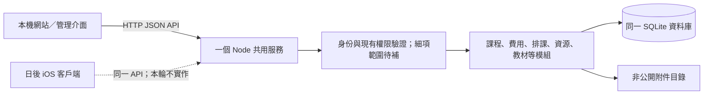

# Beamal 本機完整測試系統：共用服務與後續擴充架構

更新：2026-10-14。這是目前工作樹的架構評估與後續設計建議，並非整套 Notion 需求已完成、已部署、已 Commit 或已 push 的聲明。本輪只整理文件，沒有修改正式程式、真實資料或外部服務。

## 1. 目標與需求依據

本輪最終交付以**本機完整測試系統**為準：多人登入、同一份業務資料、完整操作、付款／收據／通知使用測試模式。雲端部署、SEO 與 iOS App 本輪先不做；保留日後網站與 iOS 共用同一後端的接口。

依據：[Notion 原文快照](notion-requirements-source.md)及 [111 行需求登記表快照](notion-requirements-register-source.json)，原頁面為 [Beamal v0.1](https://app.notion.com/p/3f5936c332a981ee92a5cfa571abd457)。登記表取回日期為 2026-10-14，`hasMore:false`；111 行包含 92 項已確認、9 項待細化、9 項待討論及 1 項暫緩。這些是**來源狀態**，不是完成數量。

使用者最新指定的測試規模是 **4 位老師、300 名 active 學生、6 種課程、3–18 歲**。Notion W-02 的「約 10 種課程」及各處價格／堂數例子不是程式固定值；後續合成測試資料應按最新規模建立。3–18 歲先作測試資料分布，不自行把它推導為所有註冊的硬性拒絕規則。

Notion 已確認、待討論及建模建議須分開。尤其 R-02、FAM-05、FAM-11、A-03、S-09、X-02 等仍未定稿的權限、激活前置條件、家庭驗證、扣堂和超額規則，不能因資料表方便就當成已批准政策。

## 2. 現有服務可沿用，無須拆成微服務

目前已是**真正的共用服務**，並非每個瀏覽器各自保存一份 SQLite：

用詞對照：API 是網站／App 向服務讀寫資料的接口；Node 是執行服務的程式環境；SQLite 是存於服務端的資料庫。ID 是不隨名稱改變的識別碼；version 是記錄的修改次數，用來拒絕拿舊資料覆蓋新修改。交易代表多處資料一起成功或一起撤回；audit 記錄誰在何時改了甚麼；idempotency key 則讓同一操作重試時不重複保存。

[store.mjs](../../sample/server/store.mjs) 使用 Node `node:sqlite` 的 `DatabaseSync`，各 repository 共用同一 SQLite handle；[app.mjs](../../sample/server/app.mjs) 提供 HTTP API。獨立瀏覽器／帳戶對同一服務的讀寫使用同一資料庫；前端 [api-client.js](../../sample/client/api-client.js) 明確送出單項操作，不上傳或覆蓋整份瀏覽器資料。

4 位老師與 300 名 active 學生適合先使用**一個服務程序＋分模組程式＋一個資料庫**。無須先引入大型分散式消息系統、分散式交易或每個模組一個服務。SQLite 的一個寫入者模式是否符合實際尖峰，應以本輪規模的併發量測證明，不能只按學生人數猜測。

網站現有 legacy demo／localStorage 資料仍屬示範介面來源，不是共用系統的權威資料。正式共用流程的成功回覆、版本及資料狀態必須來自 API；日後 iOS 也不得另外維護一套可自行覆蓋後端的業務資料庫。

## 3. 已有實作與證據邊界

| 已有部分 | 現有程式依據 | 本輪不能據此宣稱完成的部分 |
|---|---|---|
| 登入、會話、粗粒度角色 | `app.mjs` 的 auth routes；`store.mjs` users／sessions；`security.mjs` 密碼雜湊 | 尚無正式家庭帳戶、電話登入、激活／重設及老師授權範圍 |
| 課程與費用共用資料 | `store.mjs` courses、fees、course_fees、catalogSnapshot | 正式 enrollment、Payment History 及學生堂數仍未串接 |
| 排課系列與單堂／往後修改 | [schedules.mjs](../../sample/server/schedules.mjs)；[schedule-occurrences.js](../../sample/shared/schedule-occurrences.js) | 班內學生名單、Attendance、Available Slot 配額、個別學生調課不是現有系列修改的等價功能 |
| 老師／課室資源 | [scheduling-resources.mjs](../../sample/server/scheduling-resources.mjs) | 不是完整 Staff Profile、薪酬、請假或登入權限管理 |
| 教材與受保護附件 | [materials.mjs](../../sample/server/materials.mjs)、[attachments.mjs](../../sample/server/attachments.mjs) | 不代表付款憑證、Receipt 或家長附件已接入 |
| 版本、重試、稽核、可還原刪除 | repositories 的交易、audit、mutateOnce；Course lifecycle／schedule Undo | 不代表所有未建業務模組已具備相同保障 |

目前課程 IDs 可以是穩定的既有 seed key，例如 `art`，新記錄大多使用 UUID；不能假定所有歷史課程 ID 都是 UUID。排課老師／課室是 `teacherIds[]`／`roomIds[]`，舊文字只是快照，不會因同名自動綁定正式資料。

資源切片已在隔離 SQLite／真 HTTP 測試驗證多人讀回、版本／重試、資源欄位、舊文字兼容、停用指派及 scoped 排課；這些證據不等於 Notion 全功能驗收。本輪未重新進行全系統瀏覽器、300 學生負載或備份復原實測。

## 4. 同資料庫／同 API 的界線

目前網站使用 `/api`；開發時 [vite.config.mjs](../../sample/vite.config.mjs) 把它轉送到共用服務，正式本機 build 可由服務的 `staticDir` 提供。API payload 是 JSON／檔案 bytes，不依賴 DOM 或 browser localStorage，日後 iOS 可以直接呼叫同一套業務接口。

目前 API 邊界如下；後續模組加入同一服務，不複製現有資料建立互不相通的系統：

| API 家族 | 現有用途 |
|---|---|
| `/api/auth/session`、`login`、`logout` | 服務確認身份與會話 |
| `/api/catalog`、`courses`、`fees` | 課程／費用及關聯；catalog 支援 `since` |
| `/api/scheduling-resources` | 老師／課室資源，支援 `since`、新增／修改／停用 |
| `/api/schedules` 與 `/occurrences/:sequence` | 系列、單堂／往後操作、取消／還原，列表支援 `since` |
| `/api/courses/:id/materials`、`/api/materials/:id` | 教材列表與寫入 |
| `/api/courses/:id/material-uploads`、教材 attachments routes | 暫存上載、綁定與每次重新授權的檔案讀取 |

後續應保持：服務驗證輸入、身份、動作與記錄範圍，服務產生穩定 ID／version／時間與權威名稱，再回傳已儲存結果。前端不能自行把局部畫面成功當成已保存，也不能只靠隱藏按鈕或老師篩選器保護資料。

瀏覽器現有會話採 HttpOnly／SameSite cookie，寫入另驗 Origin 與 CSRF（防其他網站代使用者提交操作）。日後 iOS 須正式驗證其 cookie／會話儲存及 HTTPS 使用；如需要不同的 mobile token 入口，應新增同一身份服務的認證 adapter，而非建立第二套用戶或放寬瀏覽器的 Origin／CSRF 檢查。本輪不實作 mobile 登入。

## 5. 角色、授課身份與資料授權

**重要落差：現有 teacher read-all 不符合 Notion。**

- `app.mjs` 的 `/api/schedules` 目前讓 admin／teacher 讀回全校系列。
- `store.mjs` 的 catalog 對 teacher 未套「自己／獲授權課程」範圍；student 主要按 onlineStore 篩選，並非正式自己 enrollment。
- `materials.mjs` 的 `canReadCourse` 目前允許 admin／teacher 讀取所有課程教材；student 依使用者 ID 的 course_material_access grant 及 visibleToStudents 判斷。
- 資源列表目前讓 teacher 讀取所有老師／課室資料；日後哪些資源名稱／內部備註可見，也需按照實際授權決定。

R-01、R-04 與 Notion 2.1／5.1 要求 Regular Teacher 預設只看自己負責或 Admin 授權的資料。此落差是正式完成條件，不能當成只需美化的問題。

建議後續以「**動作＋資料範圍**」保存權限：例如讀自己課次、讀指定班次、改指定 Attendance、管理指定 Overall Slots。每個列表查詢先在服務端篩到可讀記錄；直接 ID、附件 URL、搜尋、匯出及事件同步也使用同一權限判斷。篩選器只控制畫面，不能放大授權範圍。

授課身份與登入角色必須分開：

- `users`：登入身份、憑證與角色。現有 enum 是 admin／teacher／student，尚無完整 Manager 或細項 permission schema。
- `scheduling_resources(kind=teacher)`：可被指派授課的老師資料；新增資源不建立 login／發 invite。
- 後續 Teacher Profile／帳戶關聯：明確把一個授課資源與已核實的 Person／login account 連結，不能按同名自動連結。
- Admin／Manager 可以同時有授課資源並出現在某堂的 teacherIds；Regular Teacher 的帳戶身份不等於全校授權。Chrome 的某個 Role dropdown 行為不能取代 Notion 的最終人員模型。

授權改變時，應有 permission revision／身份範圍標記，讓客戶端丟棄已失去權限的快取，服務拒絕舊 scope 的讀寫。現有 SDK 已防遲到的跨身份回覆覆蓋 CSRF／畫面身份；它尚不是完整的權限變更同步機制。

## 6. Student Profile、Applicant、Family 與 login 分開

FAM-01／03／04／10、T-06／07 已要求學生檔案與 login 分離。現有 `users.role=student` 是測試登入角色，不能直接作完整 Student Profile，也不能假定 300 學生要有 300 套密碼。

建議使用同一資料庫內的簡單關聯表，名稱供後續實作評審，不是已存在的 schema：

| 記錄 | 職責 |
|---|---|
| Person／Applicant／Student Profile | 學生基本資料、Applicant 到正式 Student 的獨立轉換及歷史 |
| Family／Family Member | 兄弟姐妹的可核實關聯；每個 Student 的課程、堂數與出席仍獨立 |
| Family Account Access | 某 login 可讀哪些家庭／學生；日後多監護人可擴充，驗證細節仍待定 |
| Login／Credential／Activation | 登入及一次性激活／重設，與 Convert to Student 分開 |
| Enrollment／Student Session | 正式報讀與某學生在某堂的安排／出席，而非把狀態寫到全班 |

電話登入是 Notion 的要求，但現有登入以 email 查找，尚未完成；後續應用穩定 account ID，電話只是經核實的登入名，不能因電話相同就自動合併學生／家庭。老師不得讀取密碼，只能啟動受保護的激活／重設流程。

Convert to Student 必須手動且保留同一人的申請歷史，不自動建立已激活 login。Direct Enrollment 在 Confirm Request 後可以手動轉學生；Confirm Payment 觸發課程正式生效，仍不能自動 Convert。FAM-05 的首次帳戶激活到底要等 Paid 還是 Convert 後可用，依來源保留待討論，不擅自選其中一條。

若先 Confirm Payment、後 Convert，Applicant／Student 的記錄綁定及家長端可見性亦須按來源待定事項定稿；不能為繳款流程方便而自動建立 Student。

## 7. 穩定關聯、單堂識別與交易

目前 SQLite 開啟 foreign_keys、WAL 及 busy_timeout；`store.mjs` 使用 `BEGIN IMMEDIATE`，巢狀操作以 savepoint 處理。課程、費用、關聯、version、audit 及 idempotency receipt 在同一交易完成。這種模式可延續到跨模組業務，不需另建分散式交易系統。

現有排課系列以 `schedule.id` 識別，某堂使用 **系列 ID＋不可變 sequence**；日期／時間／顯示 Session 編號都不是身份。單堂移日期仍是同一 sequence；following 只改時間會保留實際既有日曆，真正改日期規則才重建剩餘部分。未有限制的系列不預先產生無窮課次，shared helper 以有界日期窗口計算。

未來 Class Session 與 Student Session 要引用穩定課次：可在某堂首次需要名單／Attendance／付款關聯時保存 Class Session 記錄，並對 `(seriesId,sequence)` 設唯一約束。不能用日期當 key，否則改期會丟掉出席或付款關聯。已有學生／訂單的課次縮短、取消與刪除需增加相應保護或明確業務轉移規則；現有「課程有 active 排課就拒刪」尚未保護所有未建的學生／訂單依賴。

teacherIds／roomIds 目前保存在規則 JSON 內，由 `schedules.mjs` 在同一寫入交易查資源 ID、種類及啟用狀態；它們不是 SQL JSON 內的自動 foreign key。後續若需要依老師 scope 高效查詢，應增加正式 assignment／grant 關聯表及索引，保留既有穩定 IDs 與單堂例外，不按文字重新配對。

跨模組命令應只完成一次，例如：

- Trial Submit：檢查資格／配額 → 建 Request → 佔名額 → 建待辦及事件，全部提交或全部撤回；Reject 釋放對應名額並留歷史。
- 個別學生 Make Up This Class：檢查原／目標 Student Session、名額及權限 → 移動該學生的安排 → 同步名單／待辦；不能改其他學生或全班狀態。
- 測試 Confirm Payment：檢查狀態及確認金額版本 → 保存付款確認／課程生效 → 更新 Enrollment、名單、堂數及事件；不自動 Convert。

現有 `mutateOnce` 保護同一 user＋route＋key 的重試，並拒絕同 key 不同內容。後續付款／配額還要有**業務狀態與唯一約束**，避免用另一個 key 再次 Confirm 同一付款而重複入班／入帳；只靠前端禁用按鈕不足。

## 8. 多端同步與持久事件

目前 catalog／schedules／resources 的 `since=revision` 可在資料未變時回傳 unchanged，避免反覆全量下載。`src.js` 的共用 polling 目前每 5 秒及回到視窗時更新會話／課程／教材／排課；寫入端用保存回覆立即更新當前介面。這是現有刷新機制，不是已完成的即時 To-do／通知服務，也未保證另一端立即收到所有業務事件。

Notion D-03、M-04、F-07、TM-03 要求跨老師／家長／學生一致同步。建議在**同一 SQLite 交易**保存業務變更與待處理事件（outbox，即「待送出的事件清單」），由同一 Node 程序提交後分發，不需要另設消息服務：

1. 事件帶 entity ID／version／類型及唯一業務 key；待辦依學生＋申請／課次去重。
2. 客戶端依授權取得事件或更新提示，再用 API 讀權威記錄；不能把全校敏感 snapshot 廣播給所有老師。
3. 可以後續在本機加入 SSE／有游標的事件讀取，讓通知更即時；斷線重連從最後游標補讀，revision polling 作補救。
4. actor／資料權限及 scope 變動必須重新檢查；較舊版本或跨身份回覆不能覆蓋新狀態。
5. 到期提醒、試課後待辦保存 due time／完成狀態；程序重啟後補算待處理項，不能只靠一次 browser timer 或彈窗。

待辦是可追蹤的業務狀態，普通「保存成功」通知不創建 To-do。老師優先級個人設定不改其他老師排序。單堂取消與單個學生 Pending Confirmation、Attendance、Staff Leave 和普通文字 Remark 亦須保持不同粒度。

## 9. 附件與測試付款／單據／通知

現有教材附件實體放在 `dist` 外，並由 API 每次重新驗證教材與課程可讀範圍。student 還受 visibleToStudents、course grant 及下載開關限制；GET／HEAD／Range 使用同樣授權，不能因影音分段讀取繞過身份。素材上載使用 private staging、雜湊、格式辨識、50,000,000 bytes 限額及交易綁定；這不等於防毒掃描或所有未來附件類別都已驗收。

後續 FPS Slip／Receipt／Payslip 應沿用 private 檔案儲存能力，但建立其**自己的業務關聯與權限**，不能借教材公開開關決定金融或人事文件可見性。Family Account 只能取獲授權學生／交易的實際保存文件；Receipt PDF 必須能追溯交易及金額版本。

以下是後續付款／單據／通知實作的測試模式要求，**不是這些功能已接線的聲明**：

- Request／Confirm Request／Confirm Payment 各有獨立狀態，沒有真 FPS 轉帳或銀行到帳核實；上載合成憑證不會自動 Paid。
- 測試付款確認可觸發完整業務聯動，但界面和文件須清楚標為測試；Paid Receipt 只能對應測試模式下已確認付款，未確認則是 Draft／Payment Pending。
- PDF Save 可生成並保存本機測試單據；Send by Email、App Notification、WhatsApp 預覽／訊息使用測試 delivery log 或 sandbox，沒有真實發信、推送或訊息。
- 測試 delivery 狀態不得標為「家長已收」；普通 `mailto:` 若未帶正確 PDF 附件，不算完成 F-12。真正郵件 adapter／mobile push 另行授權實作。

## 10. 本機配置入口與日後搬到 server

[cli.mjs](../../sample/server/cli.mjs) 是現有啟動入口；[package.json](../../sample/package.json) 的 `api` script 會執行它。當前驗證 runtime 為 Node 22.23.1；須使用支援既有 `node:sqlite` 與依賴的 Node runtime，不將 browser SQLite 替代 server DB。

| 配置 | 現有作用 |
|---|---|
| `BEAMAL_HOST`／`BEAMAL_PORT` | 預設 127.0.0.1／5180 |
| `BEAMAL_DATA_DIR` | 預設 sample/.data，放本機私有資料與 bootstrap 檔 |
| `BEAMAL_DATABASE_PATH` | 指定 SQLite 檔；預設資料目錄中的 beamal.sqlite |
| `BEAMAL_STATIC_DIR` | 指定網站 build；預設 sample/dist |
| `BEAMAL_ALLOWED_ORIGINS` | 允許哪些網站來源發出寫入請求 |
| `BEAMAL_SECURE_COOKIES` | HTTPS 部署時可開 Secure cookie；本身不會建立 TLS／HTTPS |
| `BEAMAL_API_TARGET` | Vite 開發代理的後端地址 |
| `createApplication({attachmentsDir})` | 程式層可指定非公開檔案目錄；CLI 目前沒有獨立附件環境變數 |

本機可先 build，啟動 `npm run api --prefix sample`，同一 loopback 服務提供管理網站與 API；開發才另用 `npm run dev --prefix sample`。現有 CLI 首次建立虛構測試帳戶和 3 個示範課程，不代表自動建立最新 300 學生／6 課程測試資料；新規模 fixture 應另外明確建立在隔離路徑。

日後部署只搬同一服務、SQLite 與私有檔案，配置持久磁碟／HTTPS／允许的 origin／備份；網站與 iOS 都經此 API，不直接開 SQLite 檔案。不要把資料庫放進多台 frontend 的暫存檔案系統或由 iOS 複製修改。若將來實測需要多台寫入服務，再考慮遷移資料庫；保留 service/repository 邊界有助更換儲存而維持 API，不是現在就承諾已完成 PostgreSQL 遷移。

## 11. Migration、備份與還原

Migration 是保留舊資料下升級資料結構；snapshot 是某時間點的完整資料副本。現有 migration 是初始化時 `CREATE TABLE IF NOT EXISTS`、檢查後 `ALTER TABLE`，另用 schema_metadata 標記 normalized fees migration；資源 room metadata 也有相容新增欄位。**尚無完整的順序 migration runner、backup／restore 管理功能與還原演練。**

下一步建議：

1. 為後續業務 schema 保存有序 migration 版本；同一更新可在隔離舊資料 fixture 上重跑，不重建 users、改舊 IDs 或把已保存 labels 自動配對真人。
2. 升級前建立一致備份，記錄程式／schema 版本與檔案清單；遇到不能相容的新 schema 不靜默用舊程式寫入。
3. 本機第一版採停止寫入、停止服務並完整關閉 SQLite 後的冷備份。保護資料庫及 private attachments 為同一份 snapshot；不能在 WAL 寫入中只複製單一 .sqlite 檔就宣稱一致。若後續要不中斷服務，另外實現並驗證 SQLite 一致性備份流程。
4. 備份須包含需保存的 audit／receipt／關聯與附件 bytes，並另行保護憑證／配置；bootstrap-accounts.json 不能當公開匯出。僅複製 DB、不保存附件會產生讀不到文件的記錄。
5. 還原先到新隔離目錄，跑資料庫完整性／foreign key 檢查、課程／費用／學生／家庭關聯抽查及附件雜湊／可讀測試；再啟動相同或已兼容的服務。
6. 還原會話需明確作廢／重新登入，避免舊授權 cookie 被誤用；業務 idempotency／audit 要保留。實際換入有效資料需要獨立管理流程，本輪只規劃，不執行。

完成條件應是「從備份重新啟動、第二個帳戶讀到同一資料、可取正確受保護附件、錯誤帳戶被拒絕、重試不重複入帳」，不是只看到備份文件存在。

## 12. 4 老師／300 學生的可行測試量

下列是**隔離合成 fixture 方案，尚未執行全規模驗收**；不用真學生、付款截圖、家庭電話或外部通知。

| 資料／情境 | 建議測試配置 |
|---|---|
| 授課與管理身份 | 4 個老師 profile／resource：1 位可授課 Admin／Manager、3 位 Regular Teacher；另設純管理測試帳戶以證明管理與授課可分離 |
| 學生與家庭 | 300 active Student Profile；例如 100 單孩家庭＋100 雙孩家庭＝200 Family Groups／可獨立的家長帳戶，另有 Applicant 且不混進 active 計數 |
| 年齡 | 出生日期產生 3–18 歲分布，含生日及閏年邊界；課程年齡資格另按已確認規則，不硬編示例限制 |
| 課程與課次 | 6 課程、多價格／堂數方案；例如 40 個每週班次，52 週約 2,080 Class Sessions，300 學生每週一堂約 15,600 Student Session／Attendance 記錄；均是測試負載例子，不是營運排班承諾 |
| 人員指派 | 單／多老師與課室、Admin 授課、代課、停用資源；time-only following 保留各堂不同指派、移日仍同 sequence |
| 申請與付款 | 試課 Submit／Reject 並行、家庭多孩轉換、Student-level Pending、不同老師調課、兩種訂單路徑、未Paid／已測試確認、重複confirm及Receipt版本 |
| 授權 | Admin全校；Regular Teacher僅自己／grant；Parent A兄弟姐妹可見、Parent B直接ID不可見；grant撤回、同機切帳戶、列表／附件／匯出／同步一致 |
| 負載與重新啟動 | 先以約20個家長＋4位老師及管理端同時讀取／有限寫入，量度 API p50/p95、UI響應、資料大小及event loop delay；再關閉重開、網絡中斷／失去ACK／重試、冷備份還原 |

300 active Profile 不等於 300 人同秒登入。現有 login 節流另行測試，不為讓性能數字好看而取消保護。大量 fixture 可在一個專用隔離場景建置，不在每條細小單元測試重新建立所有帳戶。

p50 是一半請求可完成的時間，p95 是 95% 請求可完成的時間；event loop delay 用來看服務是否被工作阻塞而卡住。API 時間、頁面操作速度與最慢個案都要記錄，不能用單一平均值代表流暢。

SQLite／API 負載可用真 HTTP 測試；頁面流暢必須另外以 300 學生資料實際操作名單／搜索／分頁、班內學生、家庭切換、1–14日課表及手機版。現有 [course/fee 性能量度](performance-courses-fees.md) 與 benchmark smoke 只證明其測量範圍，不能替代學生／家庭／付款負載或瀏覽器驗收。

## 13. 後續落地順序及完成邊界

1. 先修正式人員／account link及服務端 action＋scope 權限，替換 teacher read-all；完成 Student／Applicant／Family 的穩定身份與激活邊界。
2. 加入 Enrollment／Class Session／Student Session，再接 Attendance、名額、Trial及個別調課，避免用現有 series mutation 代替學生業務。
3. 接測試付款／訂單／coupon／Receipt 與課程正式生效的原子聯動，保留人工Convert及未決政策。
4. 接同交易事件／To-do／測試通知及重啟後的提醒，再做 Staff Leave／代課／Clock／薪金等來源已確認部分；待討論細則另列未決，不偽造自動化。
5. 完成本機配置、migration、可還原備份以及300學生跨角色／多端／手機版驗收。後續 server／iOS 使用相同 API 是架構方向，**本輪不以雲部署、SEO 或 iOS 成果作交付條件**。

詳細逐行 coverage 由需求登記／差距文件追蹤；本文件只說明可沿用的服務底座、必要權限與資料邊界、後續擴充和驗證方法，不把111行來源狀態轉成111行已完成功能。
