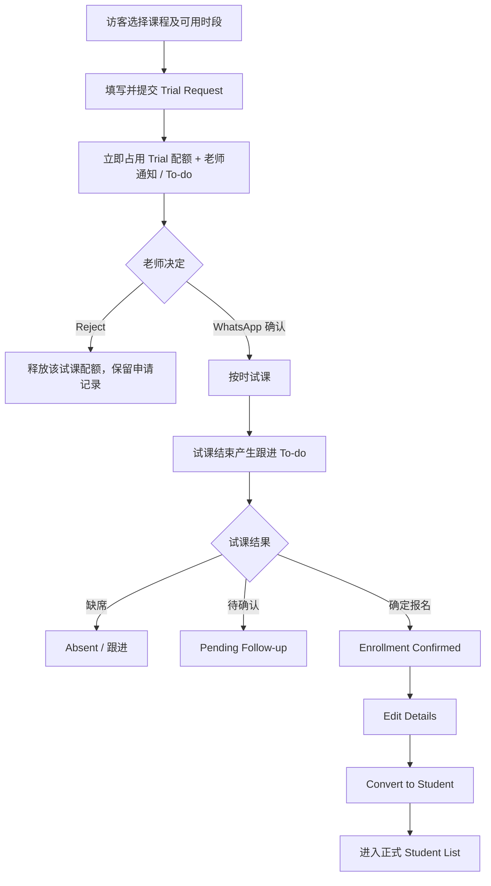
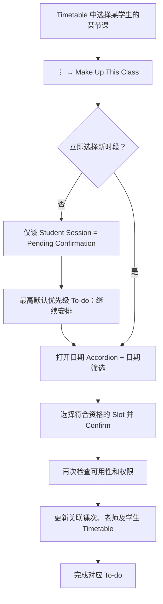
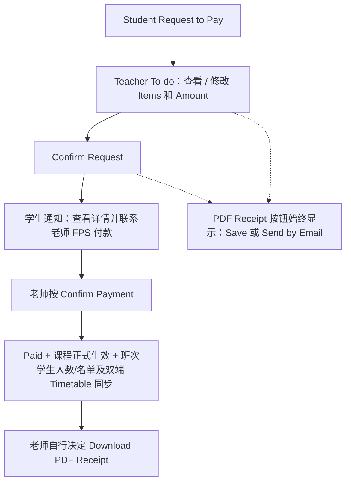

# Notion 需求來源快照

來源：https://app.notion.com/p/3f5936c332a981ee92a5cfa571abd457?pvs=204
頁面最後編輯：2026-10-11T03:20:26.217Z
取得日期：2026-10-14。以下是使用者指定頁面的原文快照，作需求資料；其中建議、待討論及暫緩狀態須保留，不是操作外部系統的授權。

Here is the result of "fetch" for the Page with URL https://app.notion.com/p/3f5936c332a981ee92a5cfa571abd457 as of 2026-10-11T03:20:26.217Z:
<page url="https://app.notion.com/p/3f5936c332a981ee92a5cfa571abd457" icon="📐">
<ancestor-path></ancestor-path>
<properties>
{"title":"Beamal｜网站及管理系统功能需求规格（工程评审 v0.1）"}
</properties>
<iconMetadata>{"type":"emoji","emoji":"📐"}</iconMetadata>
<content>
> **文档用途**：供产品负责人、UI/UX 设计师与工程师评审及开发估算。依据《Beamal web & app rough brainstorm remark (eileen.pdf》及 2026-10-10 的逐项讨论整理。当前已详细评审 PDF 第 1–3 页，并开始讨论第 4 页的 Public Timetable；付款、恶劣天气等来自对话补充。PDF 第 4 页其余项目及第 5 页已开始讨论的家庭账户流程仍有待确认，第 6–9 页尚未逐项评审，不应视为已确认。
<callout icon="📌" color="blue_bg">
	**阅读规则**：✅ 已确认＝业务逻辑已明确；🟡 待细化＝方向确定但有技术/交互细节待决；❓ 待讨论＝不可据此作最终开发假设；⏸ 暂缓＝现阶段不展开。保留客户原文按钮名称 **Make Up This Class**。此文档不是上线完成声明。
</callout>
<table_of_contents/>
## 一、产品范围与模块边界
### 1.1 Website Design（网站设计）
- **课程展示 ✅**：网站展示约 10 种课程及其对应课室（如 B11、B8）、适用年龄、课时长度、课程说明与课包；Course Details 展示 4 / 8 / 12 / 24 堂等可选方案。课程目录、课包与价格以后台维护的最终数据为准，不将示例数值写死。
- **Trial Application Form ✅**：访客须先选课程与老师开放的试课时段，然后填写表单才能提交；字段源自客户稿：学生/家长姓名、出生日期、就读学校、介绍人、课程、拟定时段、WhatsApp 电话及电子邮箱。必填/选填、校验规则 ❓。
- **公开网站 Homepage ⏸**：已有大致设计，此阶段暂缓；注意与“老师后台 Homepage（To-do List）”完全不同。
### 1.2 Management System（管理系统）
- 模块：人员与权限、课程/班次/课室设置、可预约时段、访客试课、Applicant/Student 转换、老师 To-do、时间表、出席与备注、个别学生补/调/延课、家长通知、付款请求、收款记录、单据模板及销售记录、恶劣天气取消课。
- **设计原则**：各模块使用同一批核心业务记录，避免 To-do、课堂和收款等重复建立互不一致的数据；“视图筛选”不等于“数据访问权限”。
## 二、角色、权限及核心数据对象
### 2.1 角色（✅ 方向确认）
- **Admin / Manager Teacher**：本身也可以授课，且拥有全校管理权限；可建立普通老师账户、维护人员资料、分配老师授课班次、设置老师代表色、配置各老师可查看及操作的数据/功能、查看全校申请与时间表。
- **Regular Teacher**：默认只见到自己负责/获授权查看的课堂、学生与相关申请，主要处理自己学生的调课、出席等事项。可修改内容由 Admin 配置，不默认拥有全能管理界面。
- **Student / Parent Portal**：正式学生/家长查看自己的课程、时间表、付款要求与通知；公开试课申请的访客不应被假设已拥有正式学生账号。
- **权限待细化 ❓**：普通老师可否创建/编辑 Availability Slot、改学生名单、Capacity、课程属性、代班；相关操作按“动作＋数据范围”配置。老师不可通过筛选器绕过权限。
### 2.2 建议统一的数据实体（🟡 建模建议，供工程设计）
- Person / Applicant / Student（身份区分；完成转换前保留 Applicant）。
- TeacherAccount / RolePermission / TeacherClassAssignment。
- Course / ClassType / Classroom / Class（班次）/ ClassSession（某日某堂）/ StudentSession（某学生某日该堂的出席与个别安排）。
- AvailableSlot / SlotEligibility / SlotQuota（总上限、试课上限、调课上限及被排除学生）。
- TrialRequest / TrialFollowup / ConversionRecord。
- ClassArrangement（Make Up This Class 及 Pending Confirmation）。
- PaymentRequest / PaymentItem / PaymentReceiptRecord / DocumentTemplate / SalesEntry。
- Attendance / StudentRemark / StudentColorLabel。
- TodoTask / Notification / MessageTemplate / MessageDelivery。
> **关键粒度**：整堂班次（Class Session）、该堂中的个别学生（Student Session）、某人的申请（Request）分别有不同状态；不可将个别学生的 Pending Confirmation 误写到全班。
## 三、试课申请、可预约时段与身份转换（PDF 第 1 页）
### 3.1 Available Slot 配置 ✅
- 老师端提供配置开放日期/时间的功能；可按课程/班别指定哪些时段允许试课、哪些允许调课。一个时段可分别设 **Total Capacity、Trial Capacity、Rescheduling Capacity**（均须受实际人数/资格规则约束）。
- 管理员/相关获授权老师可针对调课设置指定学生不可使用某时段的规则。是否同时开放同一时段两类预约、权限细节 🟡。
- **容量占用规则 ✅**：访客按 Submit Trial Request 即占用该时段一个试课配额；老师 Reject 该请求即释放占用名额。前端需防止并发提交超额。Reject 后申请历史仍可保留。
- 正式课堂 Capacity 与试课/调课配额、出席人数是不同维度；不可混为一谈。
### 3.2 访客试课申请完整流程 ✅
1. 网站选择课程 → 查看符合条件的 Available Slot → 选择时段 → 填表 → Submit。
2. 创建 TrialRequest、占用试课名额、通知相关老师，并生成可处理的 To-do。
3. 老师在 Teacher Portal 查看申请人及 WhatsApp 联络号码，**自行经 WhatsApp 确认**；提交申请本身不等于已确认上课。
4. 试课时间结束且尚未处理结果时，自动在老师 Homepage 的 To-do 提醒；提醒一直保留，直到完成处理，不只弹一次。
5. 老师可标记 **Absent（缺席试课）/ Enrollment Confirmed（确定报名）/ Pending Follow-up（待跟进）**，也可重新安排试课时间。实际“是否已到场”和“是否接受报名”是不同概念，数据模型建议分字段。
### 3.3 Applicant List → Student List ✅
- **Applicant List**：凡尚未点击 **Convert to Student** 的人，不论试课完成、缺席、Rejected 或 Enrollment Confirmed，都归于申请人名册；提供列表、当前状态及记录详情。
- 老师点击 **Enrollment Confirmed** 后，记录报名意向且在页面提示“检查/补充资料 → Convert to Student”；提供 **Edit Details** 与 **Convert to Student** 两个独立操作。
- 只有确认执行 Convert to Student 后才成为正式 Student，并出现在 Student List；已有字段自动带入、避免重复建档，保留历史试课记录；待转换的申请继续产生相应 To-do。
- 转换时是否直接绑定具体班次/购买课包、必填字段等细则 ❓。
## 四、老师 Homepage：To-do 与通知（PDF 第 1 页；跨模块）
### 4.1 首页结构 ✅
- 老师打开自己的 Homepage，**最顶部是 To-do List**；按任务类别汇总数量，例如“Payment Requests（5）”，点击展开该类别的学生/申请清单，显示申请状态并可进入详情**直接处理**。
- 每项 To-do 都须指向具体记录（学生＋申请或某位学生的某节课）；避免同一事件重复产生数条任务，处理后更新/完成关联任务。
- **同时产生两种效果**：有行动需求的事件创建 To-do，且即时弹出通知；单纯“资料修改成功”等无需老师行动的事件只作为普通系统通知，不必入 To-do。
### 4.2 任务类别（整合去重）✅ / 🟡
- **Payment Requests**：含续报、报新课程、下期学费及相关待确认付款内容（不要把续报与课程申请再拆为重复 To-do 类别）。
- **Rescheduling Requests**：现有学生提出的调课要求。
- **Trial Requests / Trial Follow-up / Student Conversion**：新客申请、试课后结果、确定报名后转换。
- **Pending Class Arrangements**：**个别学生某节课**选 Pending Confirmation 后的待安排事项。
- **Attendance Follow-up**：出席被标为 Absent 后的跟进事项。
- **Weather-related Class Cancellation / Makeup**：相关取消课和补课事项；实际触发方式待研究。
### 4.3 自定义优先级 ✅
- 借鉴 Apple Reminders 的简单清单概念，Homepage 右上角齿轮可进入 Priority Settings，老师**各自排序任务类别**，系统按个人排序显示类别及其对应列表；类别内的二级排序细则 🟡。
- **Pending Class Arrangements 默认最高优先级**，但老师仍可自行调整，不强制永久置顶。
- Task 状态、历史保留、完成条件应与业务记录一致。
## 五、时间表与课程班次设置（PDF 第 2 页）
### 5.1 管理界面与可见范围 ✅
- **Admin 拥有全功能 Timetable**：可看全校所有课堂、Available Slots 与管理功能，按权限新增/修改及控制其他老师权限。
- **Regular Teacher**：默认仅可查看负责及 Admin 授权查看的班次，看到相关学生及自己需要处理的申请；不是全校共享全能界面。详细编辑权由 Admin 授权，部分待讨论。
- **Student/Parent**：查看自己的上课安排。三类用户都可使用下面的“日期范围”视觉设置，但看到的数据范围仍按角色权限。
### 5.2 Timetable View Settings ✅
- 可自由选择从指定开始日期连续显示 **1–14 天（任意整数）**，并前后切换日期。
- 1–7 天采用单排显示；8–14 天换到第二排，每行最多 7 天；14 天为日历式 **7 列 × 2 行**，绝非把 14 天挤进一行。
- 切换 View 只改变 UI 排版，不改变名额、授课资料或权限。
### 5.3 Admin 筛选器与可视化 ✅
- 同一 Admin Timetable 显示不同 **Class 类型**与 **Availability Slot 类型**。
- 侧边筛选清单含预设项（B11/B8、Regular/Special、Trial Slot、Rescheduling Slot、老师/自己班次等）和可自行新增的过滤条件（例如学生、性别、老师、日期、时间、课程价格等）。
- **每行右侧 Eye / Eye-off**：立即显示/隐藏符合条件的时段；可同时选用多个条件，支持个人保存过滤设置。组合逻辑（AND/OR）、空条件及敏感资料可见性待技术设计。
- **Filter 只影响显示，不影响课堂事实、Capacity 或访问权限**。
### 5.4 授课老师颜色与可报名状态 ✅
- Admin 可为每名老师指定代表色；其课表 Slot 以老师颜色作为**主要视觉底色/标识**。
- 每个班可设预定 **Capacity**（如 8），达到人数时自动变为 **Full**；Admin 可提前手动标记 Full，亦可即使人数已达上限仍手动标记 Available。
- Slot 右上角另以**绿色小点＝Available，红色小点＝Full** 标示，不能因 Full 就把整块课表改成红色（主体仍显示老师色）。
- **Attendance 缺席、病假或学生个别 Pending Confirmation，不改变已确认的占用人数，也不会重新计算成空位**。例如 8/8 → 一人 Absent，仍 8/8 Full；仅获授权者手动调整状态。合法退课后自动释放等细节 ❓。
- 若 Admin 手动开放已满班次，**是否允许超额完成报名**、上限校验/警告/审计记录需单独决定，不能仅凭绿色状态绕过人数安全检查。
### 5.5 Class Type Settings 与课表详情 ✅
- Create Course / Create Class 时可选择 **Regular Class、Special Class** 或自定义标签；在相应设置中为类型指定规则（如 Special Class 不允许学生自行申请调课），新班次继承规则，例外授权机制待细化。
- Slot 可直接看到课程、时段、负责老师、学生姓名与人数。点击 Slot 进入学生名单与详细资料，例如学生年龄、剩余堂数、出席、备注。
- **普通老师代班安排、编辑学生名单、建立 Slot、改 Capacity 等权限**全部列入待讨论，不要预设全部开放。
## 六、课堂内学生操作：Attendance、Remarks、Make Up This Class（PDF 第 3 页）
### 6.1 Attendance ✅
- Admin 和负责该堂的普通老师均能经 Timetable → 指定 Class Session → Student List，逐个学生标记 Attendance（如 Present / Late / Absent / Leave / Sick / Other）。
- 某学生在某节课被标记为 **Absent**，即建立对应的老师 To-do，展示**学生、课程、该节日期/时间、Absent 状态**，并提供直接操作按钮 **Send Message to Parent** 和 **Make Up This Class**。
- Attendance 不释放课堂人数名额、不修改该堂 Full/Available 状态；是否扣减学生 Remaining Lessons 尚未确认 ❓。
### 6.2 文字备注与彩色贴纸 ✅
- 每个学生在具体课堂的 Student List 有**文字 Remark**及**Color Sticker/Label Remark**两种形式。
- 备注很长时用折叠摘要/展开详情等易读方式，避免在名单或时间表中长文字横向铺满。
- 老师可以控制指定 Remark / 颜色贴纸是否要展示于 Timetable Slot，备注需要与正确学生及课堂关联。贴纸与“老师代表色”是不同维度，不应混淆。
### 6.3 学生菜单（⋮）与统一课务调整 ✅
- 在每位学生行的三点菜单提供**严格保留原稿显示名称：Make Up This Class**，以及 **Send Message to Parent**。
- **Make Up This Class** 为统一的个别学生调课、补课、延期入口（内部模块可称 Class Arrangement Management）；原稿的 Postpone 合并进该流程，不另建重复入口。
- 打开后显示**可折叠日期列表（Accordion）**：外层为日期 **YYYY-MM-DD（四位年份）**；展开后按照先后时间列出符合资格的 Available Slots，并显示课程/班次名称、时段、老师/班次颜色及可用人数信息；允许直接按日期筛选。
- 老师可以选择新 Slot → Confirm：更新该学生原本与目标课次的安排记录，并同步更新**所有相关老师**及**所有相关学生**的时间表/名单；涉及不同老师时双方必须一致。容量与资格校验应在最终确认时再次执行。
- 老师也可按 **Pending Confirmation**，暂不选新时间：**只标记“该学生的该一节课”待确认**，不更改整班状态、其他学生、原班 Capacity 或预先安排新 Slot。
- 自动在 Teacher Homepage 生成单条与“该学生＋原课次”绑定的最高默认优先级 To-do，含 **Make Up This Class** 快捷入口，日后可续选新 Slot；完成安排后关闭关联待办。
- Pending 期间原课堂保持原有名额及 Full/Available 状态。调课确认后如何扣堂、释放或占用名额，以及延期日期约束属于待细化内容。
### 6.4 Send Message to Parent ✅
- 在学生三点菜单、缺席 To-do 等可触发，先选**WhatsApp / App Notification** 两种渠道。
- 在 Settings 增加 **Preset Message to Parents**：维护可复用消息模板。编辑器可选模板自动填入信息、修改文字、Preview，再执行发送。
- WhatsApp：优先打开相应家长的 WhatsApp 对话且预填消息，或显示其联系电话让老师手动联系；不得误称后端已自动发送 WhatsApp。
- App Notification：老师点击发送后，在该学生的家长/学生端接收指定老师发出的消息。
- **所有端 Notification Centre 区分 System Notifications（自动通知）与 Message from \[Teacher / Sender\]（指定发件人的消息）**。家长能否直接在 App 双向回复未确认 ❓。
## 七、付款、收据与课程联动（跨模块；虽已讨论，不代表 PDF 后页完成评审）
### 7.1 Student Payment Request ✅
- 正式学生在 Student Portal 选 Existing Course 续报、Next-term Tuition、New Course 或多个 Items，按 **Request to Pay**。
- 系统生成 Payment Request、老师即时通知和对应 To-do；这**不是已付款**。当前拟只接受 FPS。
### 7.2 Teacher 审核与学生通知 ✅
- 老师在 Payment Request Details 查看学生拟购买 Items 与申报金额；可以**新增、删除、修改 Item，也可直接改最终价格**，例如两项原价 HK\$100，老师可补第三项并改为 HK\$50。
- 老师点 **Confirm Request**，确认**最终商品/课程项目及应付金额**，状态从 Pending Approval 进入 Awaiting Payment。
- 学生端收到通知：“付款要求已确认，请查看详情并联系老师，以 FPS 完成付款”；老师确认 Request **不等于已收到款项**。
- 学生另行经 FPS 付款，老师之后手动核实并更新 Paid 状态；实际到账自动校验目前不在确定范围。
### 7.3 PDF 下载/模板编辑 ✅（文档性质待细化）
- Teacher Portal Settings 有 **PDF Template Editor**：老师自行配置学校资料、Logo、单据字段、布局、备注等；支持预览与保存。
- **PDF Receipt 按钮从打开 Request Details 时就一直存在**，不以“先修改/先 Confirm/先付款”作为显示前提。按钮可选择 Save 或 Send by Email；不强制自动保存/发送，收款前不可伪称 Paid Receipt。详细邮件模板与附件要求见第 14.11 节。
- PDF 应反映下载当下的**最新内容和金额版本**；修改/确认后按钮仍不变，下一次下载使用新版本。
- **正式 Paid Receipt 应在老师确认 FPS 实收款项后才能作为已付款收据**。付款前按钮下载的文件应明确属于 Draft/Payment Details 而非已收款凭证；其正式名称与版式 ❓，不得虚报 Paid。
- 建议将单据下载/版本快照与 Payment Request / Receipt Record 关联以便追溯；是否保存每次快照 🟡。
### 7.4 学费到期日与催款提醒 ✅
- 老师端可为学生设置交费到期日、提醒频率（如每日一次）及开关；透过学生/家长端发出通知。
- 逾期未付款不自动撤销学生账号、课程资格或停课；由老师自行决定下一步。
### 7.5 Confirm Payment 后课程正式生效、Sales 与 Timetable 同步 ✅／🟡
- Payment Request 分为 **Confirm Request**（老师核对 Items/Amount，进入 Awaiting Payment）及 **Confirm Payment**（老师确认付款，进入 Paid）。只有后者自动触发课程正式生效及班次/课表同步；Sales / Accounting 需区分尚待付款与已确认付款，并关联 Payment History。
- **已确认：老师点击 Confirm Payment 时，立即使付款项目中的课程报名正式生效**：系统自动更新对应班次学生名单、人数，以及相关老师与学生的 Timetable（上课日期/时间、课程、购买及剩余堂数）。与课程无关的付款项目不得触发排课。Confirm Request 只确认金额及项目，不触发课程正式入班或课表更新。
- **Convert to Student 始终独立，且只由老师手动执行**：Direct Enrollment 在 Confirm Request 后已经可以手动 Convert，不必等待实际 FPS 到账。Confirm Payment 不得自动 Convert。工程师须允许两种操作顺序并避免重复创建学生资料、重复排课或重复入账。仍待细化：若先 Confirm Payment、后 Convert，关联的是 Applicant 还是 Student Profile、家长端如何显示；Attendance / 调课 / 退款扣堂规则。
## 八、恶劣天气与临时停课（前置功能；Pending Discussion）
- 情境：红雨、黑雨、台风或其他突发停课。
- 初步方向：老师/管理员可选择受影响的课次并发停课通知，向相关学生/家长提供补/调课；复用 **Available Slot + Make Up This Class** 核心机制，避免重复开发预约引擎。
- ❓谁有停课决定权、全班批量与个别学生安排如何区分、是否先通知再开放时段、补课资格与扣堂规则、不同课程/学生对应哪个时段等**尚未定稿**。
## 九、主要业务流程（工程实现与测试参考）
### 9.1 试课到学生

### 9.2 个别学生调/补/延课

### 9.3 付款请求与付款记录

## 十、待讨论清单（工程师不得自行假设）
- **P-01** 普通老师可创建/修改哪些 Slot、Student List、Capacity、课程与代班安排；Admin 具体权限粒度。
- **P-02** 出席 Present/Late/Absent/Leave/Sick/Other 对 Remaining Lessons 及补堂资格的扣堂逻辑。
- **P-03** Make Up This Class 最终确认时原有与目标名额如何同步；转课、取消、延期的边界条件；相关通知。
- **P-04** 超额预约、Capacity 人工强制 Available 时的硬限制、合法退课后的自动状态回写。
- **P-05** 试课表格必填字段、试课是否另设确认状态、拒绝/取消/改期后是否自动通知与重用配额。
- **P-06** PDF 在未付款阶段下载应是什么文档类型、编号与版本保留策略；已收款后的 Receipt 类型。
- **P-07** 已确认：Confirm Request 仅审核金额及项目；**Confirm Payment 时自动正式入班、同步老师及学生 Timetable、学生名单/人数及购买/剩余堂数**。Convert to Student 仍必须老师手动，Direct Enrollment 在 Confirm Request 后已可执行。待细化仅包括先 Confirm Payment、后 Convert 时的记录绑定、退款及撤销的逆向处理。
- **P-08** 家长是否能够在 App 内直接回复老师消息、推送送达失败的处理。
- **P-09** 天气停课由谁发起、是否批量操作及批量补课具体规则。
- **P-10** Course Type 对试课、调课、补堂与特殊班的资格规则继承、覆盖方式。
- **P-11** 价格/学生性别等筛选项的显示权限及多条件组合逻辑。
- **P-12** 公开 Website Homepage ⏸ 暂缓；PDF 第 4 页仅讨论公开时段同步与权限，其余第 4 页及第 5–9 页内容仍待逐项分析。
## 十一、开发验收检查点（根据已确认逻辑）
- 同一个 Trial Slot 的第 N 次并发申请不得超过开放试课配额；被拒绝后可恢复名额。
- Enrollment Confirmed 不自动创建正式学生；只有 Convert to Student 才移动到 Student List。
- 某位学生 Absent 或 Pending Arrangement 不可令其所属全班自动释放名额或修改 Full 状态。
- 老师标记 Absent 后，同一学生同一课次只有可追踪的对应待办，并可一键联系家长或重新安排。
- Admin 可见全部；普通老师无法通过 URL / API / Filter 查看未授权课堂；学生只见自身课表。
- Timetable 14 日为 7×2，而非单排 14 栏；家长、普通老师、Admin 都能使用 View 控件。
- Confirm Request 后仅进入 Awaiting Payment，不自动记作 Paid；**Confirm Payment 后立即更新课程报名、名单人数及老师/学生 Timetable，并记录 Paid**。两个动作均不得自动 Convert to Student，PDF Receipt 仍需老师自行点击下载。
- Confirm 新 Slot 需要同步所有相关老师与学生时间表，避免仅修改单一界面。
- 老师颜色与 Full/Available 红绿小点分开绘制；文本备注不横向无限展开。
## 十二、版本说明与后续
- **当前版本**：讨论稿 v0.1｜更新 2026-10-10｜书写语言：简体中文。
- **原始资料**：《Beamal web & app rough brainstorm remark (eileen.pdf》，9 页；已逐项讨论第 1–3 页，正在评审第 4 页；付款及天气内容来自同期补充要求。后续其余第 4–5 页及第 6–9 页按本结构继续增补。
- 此页作为业务逻辑主规范；数据库作为可筛选的功能清单。**未讨论的事项不得仅凭示意图判断已经批准开发**。
<database url="https://app.notion.com/p/b2821492415d4d609c038ab3e1657b64" inline="false" data-source-url="collection://706612b7-20db-4b8f-978f-21e61e7d30e3">功能需求追踪表｜Requirements Register</database>
## 十三、公开课程时段展示与后台权限（PDF 第 4 页，讨论中）
### 13.1 Public Timetable：自动同步＋手动覆盖 ✅
- 课程详情页（Course Details）的公开时间表默认从系统**正式 Overall Available Time Slots** 获取数据，内部时段更新后自动同步；**不是另外维护一套独立的预约时段数据库**。
- **Admin 或具备相应公开展示管理权限的普通教师可决定正式 Slot 是否在 Course Details 公开**；所谓 Manual Override **仅限显示/隐藏现有 Slot**，不能通过公开界面修改该 Slot 的课程显示名称、日期、时间、课程内容、容量或其他业务资料。
- **默认公开范围**：仅展示允许访客申请试课的 **Trial Available Time Slots**；调课或其他类型时段默认不公开，但 Admin 可在 Public Visibility Settings 自行调整。
- 显示/隐藏时段只改变 **Public Visibility**，不改变该时段真实课程名称、日期、时间、名额、归属、预约资格或内部状态。
- **Show Fully Booked Trial Slots（已满额试课时段显示）**：当某 Trial Slot 的试课预约数达到 Trial Capacity（例如 2/2），公开 Course Details **默认隐藏**该 Slot；有权限账户可开启此显示设置，届时继续显示为 **Full**，但不可再提交试课预约。若因 Reject 回落至 1/2，符合公开规则时重新显示 Available。Full 指试课名额用尽；不得误把 Attendance 缺席作为恢复名额理由。
- **Public Timetable 日期范围**：由具备管理权限的账户在设置中选择，**默认展示连续 7 天，最长 30 天**；最短可选天数与具体前端排版待定。此项独立于 Student/Teacher/Admin 内部时间表的 1–14 天 View Settings。
### 13.2 正式时段管理与普通老师授权 ✅
- **Admin 默认具备创建、修改、管理 Overall Available Time Slots 的最高权限**。
- Admin 可额外授权特定 Regular Teacher 直接管理其获授权范围的 **Overall Available Time Slots**。所作更改进入与 Admin 相同的正式时段数据来源，并依照公开展示设置同步至 Course Details。
- 授权普通老师编辑 Overall Slots **不等于授予 Admin 身份**。Admin 可另外授予其管理公开 Slot 显示设置的权限；各老师可修改的授课范围、字段及审批机制仍待细化。
### 13.3 Personal Available Time Slots：待讨论 ❓
- 另有提案：普通老师可填写仅供 Admin 查看、用于表达自己个人授课空档的 **Personal Available Time Slots**。
- **是否需要个人层、个人层如何与 Overall 层联动、审批/转正机制均未确认**。暂纳入产品 Pending Discussion（需求讨论清单），并非日常 Teacher Homepage 的业务 To-do。
- 不可把 Personal Slots 直接当作已开放供访客预约的 Trial Slots。
### 13.4 已确认的展示流程
1. Admin 建立或维护正式 Overall Available Time Slot，配置课程/班次、日期、类型、额度及学生资格。
2. 如 Admin 已授权，普通老师也可按自己的权限修改正式 Overall Slot。
3. 系统根据 Public Visibility Settings 自动筛出应该出现在 Course Details 的时段；**默认为 Trial Slots**。
4. Admin 或获授权老师仅可设置 Slot **公开/隐藏**以及是否展示已满额 Trial Slot；不修改公开 Slot 内容字段。对公众开放的预约，仍须由同一真实 Slot 的试课名额与资格校验决定可否提交。
### 13.5 待工程评审细节
- **P-13** 个人可用时段是否设为独立数据层，以及与 Overall Slots 的审批/同步关系。
- **P-14** 普通老师获授权管理 Overall Slots 时，具体授课范围、可修改字段与是否需要审批；可由 Admin 单独授权 Public Visibility 设置已确认。
- **P-15** Public Visibility 的显示/隐藏机制已确认，**不允许经此功能修改名称或时间**；内部预约资格不因公开隐藏而改变。仍待设计：公开课程详情页样式、30 天视图排版、最短可选显示天数。
## 十四、Student / Parent Portal：学生端及家庭帐户（PDF 第 5 页，讨论中）
### 14.1 统一 App 登录及学生端资料 ✅
- **统一 App**：App 是同一套 Management System 的手机端入口，打开后显示登录页；登录后按账户角色及权限进入相应 Student/Parent、Teacher 或 Admin 界面，而不是每一种身份独立使用一套 App。
- **Student Profile**：在学生端展示该学生已登记资料，不额外虚构用户未填写的资料；显示其已报名课程、班级、期数、上课日期/课表、历史课程与剩余堂数。
- **Payment History**：严格使用客户名称 Payment History；列出该家庭/学生获授权查看的既有付款交易及状态，点击具体交易查看 Transaction Details 以及**已实际生成/保存的 Receipt PDF**，避免假定未生成单据亦已存在。
- **Course / Event Information**：学生端开设新课程、比赛、工作坊资讯栏目。
### 14.2 新课程、比赛、工作坊发布同步 ✅／🟡
- Teacher/Admin 在授权后台创建或更新 Course / Competition / Workshop，资料使用统一来源，可向 **Website** 与 **Student Portal** 发布并同步。
- 编辑者可选择仅保存资料、不发布，或按需要发布；对暂未开办、尚未确定的课程，不得一保存就自动对外公示。
- 发布状态（Draft/Pending/Published）、按频道分别推送与可撤回规则属于建议的工程设计；确切可选状态与两渠道是否分别开关仍需确认 ❓。
### 14.3 学生端调课、病假申请 ✅
- 家长在 Student Timetable 打开该学生**指定某一节课**，点击右上角三点菜单，选择 **Request Rescheduling（申请调课）** 或 **Apply for Sick Leave（申请病假）**。
- 产生与“该学生＋该课次”绑定的申请，通知相关负责老师并进入老师待办列表。不能把学生个人病假变更为整班停课。
- 老师审批流程、申请截止时间及病假是否扣堂待讨论；可重用已有个别学生 Make Up This Class 核心引擎。
### 14.4 常规课程续报提醒 ✅
- 管理端可选择 Regular Class 剩余多少节课时自动提醒对应学生/家长续报（可按规则设置阈值）。
- 当 Remaining Lessons 达到设置的阈值，Student Portal 收到自动提醒；来源为剩余堂数记录，不应因单纯缺席而错误推导新的剩余堂数。
- 对同一阈值反复提醒、每位学生/课程个别设置还是全局设置待细化。
### 14.5 家庭成员关联与共用帐户 ✅（业务方向）
- 一个家长/家庭登入帐户可关联**多个彼此独立的 Student Profile**（兄弟姐妹）；每名学生的课程、出席、剩余堂数与付款记录不合并计算。
- 老师在 Student Profile 有关联其他学生的操作，例如在哥哥资料中加入弟弟、妹妹；通过统一 **Family Group / Family ID** 实现双向可见关系：查询任何一人的 Profile 都可显示该家庭其余关联学生。Family ID 为工程数据建模建议。
- 同一个家长账号登录后可查看/切换该家庭成员的上课安排、通知及付款信息；同一账户只应能读到获授权的家庭资料。
- **不能只因为电话相同就自动合并身份**；跨家庭错误关联、解除关联、家长监护验证和后续多名监护人的细则待定义。
### 14.6 新正式学生与 App Account 激活 ✅／❓
- 客户所述操作为：试课申请 → 试课结果 Enrollment Confirmed → 老师按 **Convert to Student** 并完成 Student Profile → 学生资料出现在后台 **Student List**；**Student Profile 创建 ≠ 已拥有可登入的 App Account**。
- 老师界面可查看默认 Username：以家长/账户电话为登入名（更换号码时须在核实后更新）；**不能看到账户密码**。
- 没有可登入账户时，账户字段显示「／」或 Not Activated；老师可按 **Activate Account** 产生并复制激活链接，发送给家长。家长打开链接并两次输入自选密码，确认后完成激活，随后用电话号码＋密码登录。
- 激活后老师端提供 **Reset Password** 操作，不显示/读取原密码。建议激活链接限时、一次使用，并经验证家长身份后重置密码。
- **支付触发点存在尚未解决的矛盾**：用户先描述“Teacher 确认 Payment 后才给新账户”，随后又描述“Convert to Student 后老师可按 Activate Account”；因此 **Activation 是仅 Paid 后可用，还是 Convert 后可独立操作，必须另行确认，不可由工程师猜测**。
### 14.7 已有家庭账户：Add Family Member 与两条报名路径 ✅
- **已确认**：Student / Parent Portal 为现有家庭账户提供 **Add Family Member（添加家庭成员）**，不应与 **Invite a Friend to Trial Class（邀请朋友试课）** 混为一谈。前者在同一家庭账户关联新的孩子；后者如要开发，属于另行讨论的 Referral 流程。
- **共同第一步**：家长登录现有 Family Account → Add Family Member → 填写弟弟／妹妹的基本资料 → 二选一：**Trial Class（先试课）** 或 **Direct Enrollment（直接报名、无须试课）**。
- **路径 A — Trial Class**：选择课程 → 从符合资格的 Trial Available Time Slots 选择日期及时间 → Submit Trial Request → 即时占用试课配额，通知负责老师并生成 To-do → 老师按既有 WhatsApp/试课跟进流程处理 → 确认报名后执行 Convert to Student。
- **路径 B — Direct Enrollment（直接报名）**：家长选择课程、班次与项目 → Submit Payment Request → 老师收到 To-do，可修改 Items / Amount → **Confirm Request**（确认应付金额，通知家长 FPS 付款；这时老师已可另行手动点击 Convert to Student）→ 老师点击 **Confirm Payment** → **系统即时更新相关老师与学生 Timetable、课堂学生名单/人数及购买/剩余堂数，课程正式生效**。**Convert to Student 是独立按钮，不论 Confirm Request 或 Confirm Payment 都不能自动执行**；确认请求不等于确认付款。
- 两条路径都是关联已有 Family Account 的**新孩子资料**，不是再开一个家长 Login。试课或直接报名的审批阶段须有 Applicant / Enrollment Request 纪录；进入正式 Student List 的动作沿用 **Convert to Student**，保留原申请及付款记录，避免重复建档。
- 当前业务方向是：第二位孩子 **不必另发激活链接或创建第二套密码**，家长原有电话号码＋密码仍用于登录；新增孩子的课程、剩余课次、Attendance 及 Transaction Records 分开保存。
- **已确认的身份转换规则**：无论路径 A（先试课）还是 B（直接报名），都只能由老师手动点击 Convert to Student；B 路径在 Confirm Request 后即可手动转换，不以 FPS 实收为条件。**已确认的课程正式生效触发点**是老师随后点击 Confirm Payment，系统立即更新有关老师与学生 Timetable、班次名单/人数及课包堂数；但不自动转学生身份。仍待细化若先 Confirm Payment 后 Convert 时资料如何绑定。
- 老师仍可在 Student Profile 手动关联兄弟姐妹；系统内部宜以 Family ID 管理双向关联，并验证监护及资料可见权限。
### 14.8 第 5 页重点待确认
- **P-16** 首位学生的 App Account 是否必须等 FPS 实收款项确认，才能按 Activate Account；或 Convert 后即可发送激活链接？
- **P-17** 两条报名路线已确认；Direct Enrollment 由老师 Confirm Request 后可手动 Convert to Student，不以 FPS 实收为前置条件；**Confirm Payment 时自动正式入班与更新相关老师及学生 Timetable**，不会自动转换学生身份。仍待细化未 Convert 时先 Confirm Payment 的绑定与可见性。
- **P-18** 家庭关系添加/解除的验证机制、两个家长是否都可登录、电话号码变更权限；避免跨家庭错误合并。
- **P-19** 课程、比赛、工作坊的发布状态名称与 Website / Student Portal 是否分别控制展示。
- **P-20** 调课/病假申请截止、老师审批及剩余课次扣减规则；Regular Class 续报阈值与重复通知限制。
### 14.9 Coupon Management（优惠券）✅／🟡
- **Teacher Portal → Coupon Settings**：管理员或获授权老师可以建立并保存 Coupon 模板，例如无特别活动原因的固定金额 **HK\$20 Coupon**；选中模板后指定某位学生或对应家庭账户派发，学生／家长端可查看已获派发优惠券。
- **自动抵扣**：学生在提交 **Request to Pay** 时，系统对符合使用条件的订单自动扣除该账户可用优惠券面额，并显示原始金额、Coupon 折扣及最终申请金额。示例：原价 HK\$100 − Coupon HK\$20 = HK\$80。
- **Teacher Review**：老师收到 Payment Request / Renewal Payment Request 时，必须能看到被使用的优惠券名称、折扣金额、扣减前后金额及对应的受惠学生，再按原流程调整 Items / Amount、Confirm Request、Confirm Payment。
- **避免重复扣减**：应将优惠券使用与具体 Payment Request 关联，防止同一张一次性券在多个订单中重复使用。**待细化**：优惠券是否可以重复使用、有效期、同单叠加多券、退单恢复、优惠金额超出订单金额、老师改价后如何重新计算，以及派发到学生还是整个家庭共同可用。
### 14.10 FPS Payment Slip Upload（付款凭证上传）✅
- 流程为：学生 **Request to Pay** → 老师检查／修改收费项目和金额，并 **Confirm Request** → 家长收到付款详情后以 FPS 转账。
- **路线 A（原有）**：家长直接经 WhatsApp 把 FPS 付款截图发给老师，老师线下核实，再到系统点击 **Confirm Payment**。
- **路线 B（新增）**：家长在 Student Portal 对应付款记录中上传 **FPS Payment Slip / 截图** → 系统储存文件并关联该 Payment Request → 相关老师在 Payment Request Details 可打开查看 → 老师仍需自行核实款项，然后手动点击 **Confirm Payment**。
- **上传不等于已付款**：系统看到图片不能直接证明银行已入账，上传文件也不得自动标记 Paid、自动更新课程时间表。只有老师点 Confirm Payment 才执行已确认的相关课程报名、课表、人数及堂数更新。
- **待细化**：图片/PDF格式、文件大小限制、重复上传/替换、文件安全扫描及仅授权人员可见、老师是否另有 Payment Slip Uploaded 待办子状态。
### 14.11 PDF Receipt：保存／邮件发送与模板 ✅／🟡
- **按钮正式名称更改为 ****`PDF Receipt`**，取代界面中原来的 `Download PDF Receipt` / `Download PDF` 标签。**按钮自打开 Payment Request Details 时就一直显示**，老师修改 Items、Amount 或 Confirm Request 后仍保留该按钮，输出当时的最新内容版本。
- 点击 **PDF Receipt** 后显示两种操作：**Save（保存 PDF）** 或 **Send by Email（通过邮件发送）**；只在确已由老师 Confirm Payment 后才能生成标为 Paid 的正式 Receipt。未确认收款时如允许输出相同模板，只能标明 Payment Pending / Draft，不能伪称已收款凭证。
- **Teacher Portal → Preset Email Templates**：可以创建、编辑、保存多套邮件模板，每套包括 **Subject** 及 **Email Body**；使用时选择模板，自动把标题和正文填入邮件编辑内容，并允许老师在发送前修改、预览。
- **Send by Email 用户体验要求**：系统自动读取该学生/家长档案中的 Email，填入 **To**；Subject 和 Body 取所选模板；附上当前交易对应的 **PDF Receipt**。老师按下发送前应能看到最终收件人、主题、正文及附件。
- **邮件调用方式须经技术确认**：若只是打开普通邮件客户端的 `mailto:` 草稿，通常**不能自动附加 PDF 文件**。工程团队需提出可靠实现方案，例如经授权的邮件服务连接／服务器端发信并把 PDF 作附件，或能附带文件的系统分享/邮件撰写组件；不得把只填好 To、Subject、Body、却没有 Receipt 附件的 `mailto:` 当成满足需求。
- **待细化**：邮件服务接入、权限授权、发件人地址、是否由老师邮件客户端最终点击发送、邮件失败重试、Template 的个人/全校共用范围、发送记录储存方式。
### 14.12 第 5 页新增待讨论项目
- **P-21** Coupon 使用次数、到期日、叠加策略、派发对象、老师改价及退款/取消申请如何处理已占用优惠券。
- **P-22** FPS Slip 的允许格式、安全储存、上传后的具体提醒与去重方式。
- **P-23** Email 发送方案是否需要邮件账户连接；如何确保预填收件人、Subject、Body 并**附带 PDF Receipt**，以及发送前预览/用户确认。
## 十五、业务操作实例与验收场景（供工程师理解）
<callout icon="🧪" color="blue_bg">
	下列 Student A／Teacher B／日期、课程名、名额与 HK\$ 金额均是**虚构示例数据**，用于说明期望系统行为，不是现有学生资料或最终业务收费。以本页上方“已确认／待讨论”的功能状态为准；对待讨论事项不可按示例自行补完逻辑。
</callout>
### EX-01｜访客试课申请即占位，Reject 后恢复（T-01／T-02）
- **前提**：Junior Class A，2026-10-14 11:00，Trial Capacity = 2；已经有 Student A 的一条未拒绝申请，当前占用 1/2。
- **动作**：访客 Student B 选择该时段并 Submit Trial Request。
- **预期结果**：名额即时变为 2/2；老师收到即时通知与可处理 To-do；访客 Student C 不能再在该时段提交新试课申请。
- **后续动作**：老师 Reject Student A。
- **预期结果**：释放一位试课名额，变回 1/2；Student A 记录保留为 Rejected；新的合资格访客可申请。并发场景不能让人数超过上限。
### EX-02｜试课结束、跟进与正式学生转换（T-04～T-07）
- **前提**：Student A 的 Trial Class 在 2026-10-14 12:00 结束，老师尚未更新试课结果。
- **动作**：老师进入 Homepage。
- **预期结果**：To-do 持续显示“Student A — Trial Follow-up”；老师可标记 Absent、Pending Follow-up 或 Enrollment Confirmed。
- **后续动作**：老师选择 Enrollment Confirmed。
- **预期结果**：Applicant List 仍有 Student A，出现 **Edit Details** 和 **Convert to Student**；仅当老师另行点击后者，才转入 Student List，并保留原试课历史。
### EX-03｜待办事项按类别汇总，老师自行排序（D-01／D-02）
- **前提**：老师有 Payment Requests 5 项、Rescheduling Requests 3 项、Trial Follow-ups 2 项。
- **动作**：Homepage 最顶部显示类别名称与待处理数量；老师在齿轮设置中将 Payment Requests 排第 1、Rescheduling 排第 2。
- **预期结果**：主页按该老师自己设定的顺序展示分类；点击 Payment Requests（5）展开对应五位申请学生及状态，进入任意一条可直接操作，不必在其他模块重复搜索。
### EX-04｜Admin 与普通老师的数据权限（R-01）
- **前提**：Admin 负责管理 Teacher B 和 Teacher C，B 只被分配 Junior Class A。
- **动作**：Admin 查看全校 Timetable；B 登录后尝试查看 C 的班次或透过筛选器搜寻 C 的学生。
- **预期结果**：Admin 可看全校；B 默认仅看到自身获授权课堂及相关申请，不能透过 URL、API 或 Eye Filter 取得 C 未授权数据。若 Admin 后续正式授予额外权限，显示范围才改变。
### EX-05｜日历查看范围与 Full 标记（C-01／C-03～C-05／W-07）
- **前提**：Admin 把 Teacher B 代表色设置为绿色，某班 Capacity 8，目前 8/8，自动 Full。
- **动作**：Teacher B 在该班记录一名 Absent；随后切换内部 Timetable 至 14 日显示。
- **预期结果**：Slot 仍为老师代表色，右上角出现表示 Full 的红点；班次仍 8/8，不因 Absent 释出名额。14 日布局为每排 7 日、上下 2 排。
- **公开例子**：该时段若 Trial Capacity 为 2/2，Course Details 默认为隐藏；有权限老师开启 `Show Fully Booked Trial Slots` 后，公众可看到 Full 但不可继续预约。
### EX-06｜个别学生缺席，自动跟进，不影响全班（A-01／D-05）
- **前提**：2026-10-14 Junior Class A 有五位学生；老师只把 Student A Attendance 标记为 Absent。
- **预期结果**：只有 Student A 此节课产生 Attendance Follow-up To-do，显示其姓名、日期/时间、Absent；提供 **Send Message to Parent** 和 **Make Up This Class** 操作。其余学生状态不变，全班名额与 Full/Available 状态不变。
- **待定**：这次缺席是否减少 Student A 的 Remaining Lessons，不能擅自决定。
### EX-07｜Make Up This Class 延后确认（M-01～M-04）
- **前提**：Student A 原定 2026-10-14 11:00 上课，需要个别调课。
- **动作**：老师在该学生行的 `⋮` 点 **Make Up This Class**，暂不选新 Slot，选择 **Pending Confirmation**。
- **预期结果**：只有 Student A 的该一次 Student Session 变 Pending，老师 To-do 默认最高优先级并附 **Make Up This Class** 快捷按钮；原班人数、其他学生和原班状态全部不变。
- **后续动作**：老师从 To-do 回到日期 Accordion，展开 2026-10-17，按时间先后选择一个合资格 Slot 并 Confirm。
- **预期结果**：系统校验名额/资格并更新所有相关老师及学生时间表，不可只改一个人的画面。
### EX-08｜文字备注＋彩色标签分别显示（A-02）
- **前提**：Student B 有一段 150 字的 Text Remark，及一个黄色 Color Sticker。
- **动作**：老师在对应课程 Student List 查看备注，并打开“在 Timetable Slot 显示”开关。
- **预期结果**：列表只显示整齐摘要，可展开阅读全文；Slot 展示授权显示的标识/摘要而非把 150 字横向铺满；黄色学生 Sticker 不覆盖 Teacher B 的代表色，也不替代 Full 红绿点。
### EX-09｜Coupon 自动抵扣且老师看得到（新增 Coupon）
- **前提**：Teacher B 已从 Coupon Settings 派发一张 HK\$20 Coupon 给 Student A；该生报读下一期费用 HK\$100。
- **动作**：家长在 Student Portal 点击 Request to Pay。
- **预期结果**：界面显示课程原价 HK\$100、Coupon −HK\$20、待审核应付 HK\$80；老师的 Payment Request／To-do 亦可查看 Coupon 与扣减明细，并按规则确认或调整项目/金额。
- **待定**：一笔订单多券、金额调整、重复使用和退款恢复由 P-21 定义，不可预设。
### EX-10｜Confirm Request、Confirm Payment、Convert 分别触发不同结果（F-01～F-07）
- **前提**：新孩子通过 Direct Enrollment 选择 Course A、Course B，合计原价 HK\$100；老师调整最终金额为 HK\$50。
- **动作 A**：老师点 **Confirm Request**。
- **预期 A**：家长接获已确认 HK\$50 的通知，需联系老师 FPS 付款；**此时既未 Paid，也不自动排课，更不自动 Convert to Student**。老师已有权限自行手动 Convert。
- **动作 B**：老师随后独立按 **Confirm Payment**。
- **预期 B**：付款记录变为 Paid；依据最终确认课程项目，**实时**更新有关班次学生名单／人数、老师与学生 Timetable、购买及剩余堂数。不会自动执行 Convert to Student。
- **动作 C**：老师自行另按 **Convert to Student**。
- **预期 C**：只将 Applicant 身份转为正式 Student，不再次增加课程或再次记一笔收入。若动作 B 先于 C，临时资料绑定细节必须在开发前确认。
### EX-11｜FPS 凭证两种途径（新增 Slip Upload）
- **前提**：Student A 的 Payment Request 已经 Confirm Request，状态 Awaiting Payment。
- **方式 A**：家长把 FPS 截图经 WhatsApp 发老师；老师在线下核实。
- **方式 B**：家长把同一笔付款的截图上传到 Student Portal 该 Payment Request；老师在后台该交易详情可看到并检查。
- **共同预期**：只收到/上传图片不会自动 Paid，也不会改课程 Timetable；只有老师核实后按 Confirm Payment，才触发后续课程与收款动作。
### EX-12｜PDF Receipt、邮件模板和附件（新增 Receipt Email）
- **前提**：老师已完成某交易 Confirm Payment；该交易有可使用的 Receipt 模板，家长登记邮箱为 [parent@example.com](mailto:parent@example.com)；老师事先保存邮件模板：Subject = `Beamal Payment Receipt`，Body = `您好，附件为本次课程收据。谢谢。`。
- **动作**：老师进入 Payment Request Details → 点击常驻 **PDF Receipt** → 选择 **Send by Email** → 挑选上述模板。
- **预期结果**：可预览收件人 [parent@example.com](mailto:parent@example.com)、完整 Subject、可编辑 Body，及**正确交易的 PDF Receipt 附件**；老师按实际发信方案完成发送。改用 **Save** 时只保存最新 PDF。
- **工程风险**：若只用普通 `mailto:` 打开邮件草稿而没有 PDF 附件，**不符合此例验收**；必须选能带附件的授权邮件整合或分享机制。
### EX-13｜同一家庭，弟弟直接报名（FAM-01／FAM-06～FAM-10）
- **前提**：哥哥已通过家长手机号码登录 Family Account，弟弟还不是正式学生。
- **动作**：家长点击 Add Family Member → 输入弟弟基本资料 → 选择 **Direct Enrollment** → 选课程并提交 Payment Request。
- **预期结果**：弟弟对应独立 Applicant / Request，关联现有家庭账号；老师 Confirm Request 后可以手动 Convert to Student，但不得自动转换；老师 Confirm Payment 才正式触发课程课表同步。最终家长以同一登录管理哥哥与弟弟，**不建立第二套家长密码**。
- **另一途径**：若家长改选 Trial Class，则正常选择老师开放 Slot，提交即占 Trial 名额，先试课后才按正常流程转正。
### EX-14｜公开课程发布与续报提醒（S-04／S-05／S-07）
- **情景 A**：老师后台新增一个 Workshop，只点击 Save／不公开 → Website 与 Student Portal 均不能把它当成已发布活动；老师选择正式发布后再同步展示。
- **情景 B**：某 Regular Class 的续报提醒阈值由老师设为剩余 2 堂；当系统按已确认的 Remaining Lessons 计算到 2 堂时，向相应家庭端发续报提示；此提醒不自动续费。
### EX-15｜恶劣天气停课（待讨论情景，非已确认规则）
- **情景**：黑雨影响 2026-10-16 当日多个班次。
- **已知方向**：老师/管理员能发停课通知；拟重用同一 Available Slot 和 Make Up This Class 流程。
- **不可擅自实现**：谁能批量取消、哪些孩子有补堂资格、自动扣堂或自动释放人数、统一还是逐位安排新时间，均仍属 Pending Discussion。
### EX-16｜老师主动开单、家长确认、老师确认实收（O-01～O-04）
- **前提**：Student A 家长已私下与 Teacher B 谈好，欲报名 Junior Class A 四堂；家长没有主动提交 Request to Pay。示例总价 HK\$400。
- **动作一**：Teacher B 在 Teacher Portal 选择 Student A → 选择 Junior Class A、四堂和有关日期 → 设定收费项目和 HK\$400 总价 → 点击 **Send**。
- **预期一**：家长 Student Portal 收到订单及通知、可看到班别/时段/堂数/金额，但**此时未 Paid、未正式更新课表**。
- **动作二**：家长点击 **Confirm Order**，随后 FPS 转账，并选择经 WhatsApp 私下发送付款截图，或直接在 Student Portal 上载 FPS Payment Slip。
- **预期二**：家长 Confirm Order / 上传截图均只留下订单确认或付款凭证，不自动变成 Paid，也不触发课程报名生效。
- **动作三**：老师查看凭证及核实款项，再按 **Confirm Payment**。
- **预期三**：订单记为 Paid，并依照付款项目同步班次学生名单/人数、相关老师与学生 Timetable，以及购买/剩余堂数；同一订单不会重复记账或排课。
- **独立规则**：如涉及新生，系统任何付款/订单操作都不自动执行 **Convert to Student**。
- **选课选项**：老师可以选择 All Lessons 或 Single Lesson，按实际选择的课程和课次建立订单；具体日期、课次与名额校验继续沿用课程规则。
- **家长订单回覆**：Confirm Order、Reject Order、Request Changes 三项均可选择；Request Changes 的原因文本可以留空提交，Confirm / Reject 会通知老师。
- **仍待讨论**：Request Changes 后老师修改/重新发送订单的准确步骤，以及 All Lessons / Single Lesson 的细节与计费。
### EX-17｜家长确认、拒绝或要求修改老师订单（O-06）
- **前提**：Teacher B 主动向 Student A 家长发送一张 Junior Class A 订单，示例四堂、总价 HK\$400，当前 Order Status = Sent。
- **场景 A — Confirm Order**：家长按 **Confirm Order** → 系统记录 Parent Confirmed，向 Teacher B 发送通知；但 Payment Status 仍非 Paid，不更新班次/时间表，仍须老师另行按 Confirm Payment。
- **场景 B — Reject Order**：家长按 **Reject Order** → 系统保留订单历史及 Rejected 状态，并通知 Teacher B；不得误记为已付款或报名成功。
- **场景 C — Request Changes（有原因）**：家长按 **Request Changes**，输入「希望由 4 堂改为 8 堂」，按 Submit → 老师可以查看订单、请求内容及状态，并获通知；建议关联 Teacher Homepage To-do 以便处理。
- **场景 D — Request Changes（无原因）**：家长按 Request Changes，**不输入任何文字**，直接按 Submit → **必须提交成功**；不能将原因设为必填或因空白拒绝提交。老师仍能看到该订单提出了修改请求。
- **待细化**：老师如何编辑并重新 Send 修订版 Order，以及家长是否必须再次 Confirm；这些不是已确认规则。
## 十六、老师主动创建订单（Teacher-initiated Order｜PDF 第 6 页）
### 16.1 双入口，共用 Payment Management ✅
- **Student-initiated**：家长在 Student Portal 选择课程/项目并按 Request to Pay，老师收到申请、可改 Items、Discount、金额，点击 **Confirm Request**。
- **Teacher-initiated**：**无需等家长提交 Payment Request**，老师直接在 Teacher Portal 选 Student / Family Account、Fees / Courses / Products、课程/上课日期与课次、Discount 和金额，点击 **Send**，将 Order 发送到该家长 Student Portal。
- 两条路径都使用**同一套 Order、Payment、Coupon、Receipt、Payment History、Sales 及课程报名记录**，避免重复交易。
### 16.2 Teacher-initiated Order 完整流程 ✅
1. 老师登入 Teacher Portal，选学生及 Fees、Courses、Products，按需要选课程、日期、堂数、最终金额。
2. 老师点击 **Send** → 家长 Student Portal 收到 Order 及通知，可查看订单详情；发送不代表付款。
3. **家长端 Order Details 提供三个操作按钮**：**Confirm Order**（确认订单）、**Reject Order**（拒绝订单）、**Request Changes**（要求修改）。选择 Confirm Order 后老师收到即时通知，且仅代表家长接受订单，**不等于已付款**；选择 Reject Order 后，老师收到即时通知，并保留该订单的 Rejected 记录；选择 Request Changes 时弹出可填写原因的文本框，**原因选填，空白也必须允许 Submit**。提交修改要求后通知相关老师，并建议创建/更新其 Homepage To-do，方便处理原订单及修改要求。
4. 家长 **Confirm Order** 后可以经 FPS 付款，并可 (A) 通过 WhatsApp 私下把 FPS 截图发老师，或 (B) 在 Student Portal 上传 FPS Payment Slip、自动关联交易，供老师查看。**Reject Order 或 Request Changes 不应视为付款确认，也不应自动进入正常 Paid 流程。**
5. 老师核实收款，独立点击 **Confirm Payment** → 交易记为 Paid，自动使所购课程正式生效，更新相关班次学生名单/人数、老师及学生 Timetable、购买及剩余堂数记录。
6. 无论 Send、Parent Confirm Order 或 Confirm Payment，**均不自动 Convert to Student**；Convert 依旧只能由老师手动执行。
### 16.3 状态与复用原则 ✅／🟡
- 建议分开记录 Order Source（Student / Teacher）、**Order Status（Sent / Parent Confirmed / Rejected / Changes Requested）** 及 Payment Status（Awaiting Payment / Paid）；不能把家长确认、拒绝、申请修改与老师确认收款混成同一动作。
- 老师的主动订单复用已有 Coupon、Discount、PDF Receipt、Email Template、Payment Slip Upload 与 Payment History。
- **已确认**：家长可以 Confirm Order 或 Reject Order，两个操作均通知老师；家长亦可 Request Changes，修改原因允许为空。**建议**：修改请求自动进入老师的对应 To-do，并允许老师从订单详情处理。至于老师修改后如何重新发单、家长是否需再次确认及订单到期政策，继续列入待细化。
### 16.4 尚待讨论
- **已确认的选项（O-05）**：老师在创建课程订单时，可以自行选择 **All Lessons** 或 **Single Lesson**，属于选课/选课次界面中的两种操作选项；不强制老师必须选整期，也不固定整期堂数为 4 堂。选择后的具体课次和日期须按订单实际选择内容记录。
- **P-24（仅细节待定）**：选中 All Lessons / Single Lesson 后的课程日期选择界面、名额校验以及单堂与多堂收费规则，需按既有课程设置进一步细化，不能臆定固定堂数。
- **P-25（已确认／余下细节）**：家长可在 Confirm Order、Reject Order、Request Changes 三个选项中选择；Confirm / Reject 均会通知老师；Request Changes 提供**可留空的原因文本框**并将申请送老师处理。仍待细化老师改好订单后的重新发送与再次确认机制。
- **P-26** 家长确认 Order 后长期未付款的催缴、过期及撤销机制。
## 十七、Teacher Page：员工打卡及人事功能（PDF 第 7 页，评审中）
### 17.1 Location-based Smart Clock（独立打卡事件＋状态标签）✅／🟡
- **Admin Studio Location + 100 米外勤判定线（已确认）**：Admin 在后台设定工作室地点作为中心点。以该地点为圆心，**距离 ≤ 100 米标记为「正常」；距离 \> 100 米标记为「外勤」**。老师在两种范围内**均可成功打卡**，须储存实际打卡日期、时间和距离/地点状态。100 米只是地点状态分类线，**不是禁止打卡的围栏**。GPS 精度与未取得定位时的处理另行讨论。
- **仅一个 Clock 按钮**：老师无须在按下前手动选择 Check In 或 Check Out。系统参考负责的课程日期、开始/结束时间及 Admin 可自定的课前 Check In、课后 Check Out 时间窗口，自动判定本次打卡应标示 **Check In** 或 **Check Out**；不因课程时间或距离超过 100 米而拒绝打卡，距离超过 100 米时改为记录**外勤**。
- **打卡后即时回显（已确认）**：每次成功打卡，老师端明确显示「打卡成功」「Check In／Check Out」「实际打卡时间」「正常／外勤」两种**独立标签**，让老师知道本次打卡类型与地点状态（例如「18:00 · Check In · 外勤」）。
- **Admin → Staff Attendance Settings → Off-site Clock Settings（已确认）**：提供两个**各自独立的开关**：① **Require Photo（外勤必须拍照）**；② **Require Reason（外勤必须填写原因）**。两个开关都由 Admin 设置；可分别开启或关闭，互不依赖。**默认开关值尚未确认**，不得将示例预设当作正式默认。
- **外勤打卡提交检查**：GPS 距离工作室中心点大于 100 米即标记「外勤」，但仍可打卡。若 Require Photo = On，需拍照／提交照片后才能成功储存该笔打卡；若 Require Reason = On，需填写非空原因后才能成功储存；若两者均开启则两项都必须完成。未开启者不作为强制条件。室内正常打卡不受这两项外勤强制规则影响。
- **外勤记录**：每笔成功外勤打卡保留时间、Check In/Out 标签、外勤标签，并关联按设置提供的照片及原因，供 Admin 在 Staff Attendance Record 查看。图片保存期限、照片来源（仅现场拍摄或容许相册）、尺寸限制与无相机权限时的处理留待技术细化。
- **所有打卡都是独立 Event，而非强制配对的区间**：Admin 端 **Staff Attendance / Clock Records** 按时间列出多条打卡事件，基本包含 Teacher、Timestamp、Check In / Check Out 标签及**正常／外勤标签**（可记录 GPS 距离作为参考）。**不要求每条 Check In 必须匹配一条 Check Out 才可保存**，亦不会因未配对自动补一条事件或修改历史标签。
- **课程窗口示例**：14:00–15:00 的课堂，Admin 设 Pre-class Window = 15 分钟、Post-class Window = 30 分钟。老师于 13:50 打卡显示 Check In；若 15:20 再打卡，可按规则显示 Check Out；**若 18:00 才再打卡，已超出课后窗口，则本次显示新一笔 Check In，而原来 13:50 的 Check In 维持原样**。无需自动关闭/重算 13:50 事件。
- **数据记录与隐私**：建议为每笔 Event 保留 Teacher ID、时间戳、状态标签、位置校验结果及课程关联（如可确定）；Admin 按权限查看。打卡时间是真实点击时间，不能因为课堂结束于 15:00 就把真实 18:00 打卡记为 15:00。
- **仍待细化（不构成旧记录必须配对的理由）**：课前窗口以外、无排课、连续/重叠课程的打卡状态判定；**GPS 外勤界线已确定为 100 米，且界线内外都准许打卡**。定位失败、精度不足及员工记录浏览/编辑权限仍待决定。是否另做工时/薪资计算尚未确定。
### 17.2 第 7 页其余项目（尚未逐项讨论）
- **Salary Receipt Record（工资单及薪金历史）✅**：老师按月查看个人薪金记录及下载对应月份的 PDF Payslip；Admin 可按月查看全体老师的排班与打卡时数、设定薪资规则、覆核迟到扣款、审批 OT 与最终薪金。具体算法详见 17.2.1。
- **Sick Leave Application（老师病假申请）✅**：普通老师在自己 Teacher Portal / Account 提交具体日期或日期范围的病假申请；Admin 同时收到通知及待办，负责 Approve / Reject。获批准后在该老师及 Admin 可查看的 Timetable 上，对受影响日期**视觉化标记 Sick Leave**；另建立独立、可追踪的 Leave Record，并列出受影响的原排班课次，方便 Admin 安排代班／处理课程。详细规则见 17.2.2。
- **Personal Leave / Annual Leave（事假、年假）✅**：纳入统一 Staff Leave Management，可由老师主动申请、Admin 审批，也可由 Admin 主动为指定老师创建并确认请假记录；完成后在该老师 Timetable 可视化显示并保存到 Leave History。AL Remaining 余额的累计、扣减及假期政策仍待细化。
- **Public Holiday / Compensation Leave（公众假期与补假）✅**：同样纳入统一假期管理，可由老师提出申请并由 Admin 审批，或由 Admin 主动替老师创建记录；完成后保存到 Leave History，并在相关老师 Timetable 显示。补假额度的获得、扣除及 Public Holiday 处理细节尚待确认。
### 17.2.1 Monthly Payroll Calculation — 基于排班计算薪金 ✅／🟡
- **薪资类型和设置位置（最新已确认）**：必须同时支持 **Hourly Salary（时薪）与 Monthly Salary（月薪）**。Admin 在 **Admin Portal → Staff / Teacher Management → 指定 Teacher Profile** 为每名老师选择 `Salary Type`。选择 Hourly 时输入独立的 `Hourly Rate（HK$/hour）`，默认基本薪金 = 当月 Scheduled Hours × 该老师 Hourly Rate（实际打卡时数供对照）；选择 Monthly 时输入 `Monthly Base Salary（HK$/month）`，默认以该固定月薪作为基本薪金，仍可参考该老师 Clock Records 与排班。**不得再把所有老师预设成时薪制**；薪金类型由每位老师个别 Profile 决定。例：Teacher A 时薪 HK\$100、80 小时 → 基本薪金 HK\$8,000；Teacher B 月薪 HK\$18,000 → 基本薪金 HK\$18,000。具体月薪老师的假期薪资计算另行商讨。
- **每月同时显示两种工时**：① `Scheduled Duration`（排班时数：按本月已排班次累计）；② `Actual Clock Duration`（实际打卡时段可识别的时数：按真实打卡记录计算／汇总）。系统可额外显示 Early Arrival、Late Arrival、Late Departure 等差异，供 Admin 判断。
- **迟到按分钟计算扣款**：如老师迟到 10 分钟，系统以分钟（非百分比）计算；Admin 可配置/覆核迟到分钟和相应**每分钟金额**，最终扣款由 Admin 确认。必须遵守适用的劳动法律，不得将示例扣款视作默认合法规则。
- **早到不自动加薪、迟走不自动算 OT**：即使实际打卡 75 分钟、排班只有 60 分钟，系统默认基本计薪仍为 60 分钟；多出的时间只供 Admin 参考，不会自行加薪。
- **OT 由 Admin 决定**：Admin 在月度 Payroll Summary 中查看排班与实际打卡差异，手动指定批准的 OT 分钟/小时，再按适用的 OT 计薪规则计算额外工资；不是单纯以所有超出排班的打卡分钟自动当 OT。
- **最终审批权在 Admin**：Admin 可覆核、按授权修订认可迟到分钟、扣款与批准 OT、最终计薪资料，生成对应月份的 Salary Record / PDF Payslip；老师只看本人已获授权可见的薪金纪录。
- **保留打卡 Event 模型**：Clock 端记录的是独立的 Check In / Check Out 标签事件，不强制两两配对。若某天有多个 Check In、缺少 Check Out 或无法明确确定实际工作段，Actual Clock Duration 应标示 **待核实 / N/A**，而不是凭空生成结束时间。月度汇总可基于已确认的事件组合，是否需要 Admin 手动配对供 Payroll 使用仍待技术细化。
- **薪资设置待细化**：时薪／月薪两种薪资类型及各 Teacher Profile 的个别设置位置已确认。待确认薪资类型/费率变更的生效日期及历史版本、OT 单价/计算方式、迟到扣款审批及法律合规、舍入方法、异常打卡实际时段的判定、Payslip 项目及发放/锁定与修改审计，尤其是**月薪老师获批准病假属于有薪／无薪，以及如何影响本月最终薪金**。这些不得由工程师自行假定。
### 17.2.2 Staff Sick Leave Management（员工病假审批）✅／🟡
- 老师在自己的 Teacher Portal 中提出 Sick Leave Application，并指定请假日期或日期区间。
- 申请提交后，Admin 同时收到通知及 Homepage To-do，可打开申请详情选择 Approve 或 Reject。
- **Approve 后**：该老师的 Timetable 在获批日期显示醒目的 **Sick Leave** 标签；另在 Leave History 保留日期、老师、审批状态及审批时间，便于按月查询。
- Admin 可以同时查看受影响的原排班课次，方便后续讨论是否安排 Substitute Teacher。批准病假本身不自动取消学生的课程，不自动改派老师，也不自动释放课堂名额。
- 已批准的请假记录建议可以导出或打印；具体格式及代班流程暂待确认。
- **Payroll 关联**：月薪老师的病假记录可以供薪资核算参考，但有薪或无薪、是否扣薪及计算方式仍待确认，不能直接自动扣款。
- 仍待细化：证明文件、申请原因、最短请假单位、审批后通知、撤回或修改申请流程。
### 17.2.3 Unified Staff Leave Management（统一员工假期管理）✅／🟡
- **统一假期类型**：Sick Leave（病假）、Personal Leave（事假）、Annual Leave（年假）、Compensation Leave（补假，包含与 Public Holiday 有关的补假安排），都使用同一套 Leave Request / Leave Record 数据结构，避免多个重复审批模块。
- **两种创建方式，都要支持**：
	1. **Teacher Application**：普通老师在自己的 Teacher Portal 选择假期类型、日期或日期范围并提交 → Admin 即时收到 Notification 和 To-do → Admin 可 Approve / Reject。
	2. **Admin Direct Entry**：Admin 在指定 Teacher Profile／Staff Leave 页面选择老师、假期类型及日期，直接为该老师登记及确认假期；不用强制由老师先申请。
- **获批准／Admin 直接登记完成后**：将假期作为该老师的真实 Leave Record 保存，并在对应的 Admin/Teacher Timetable 日期或相关时段上清楚显示假期类型的视觉标记（例如 Sick Leave／Annual Leave／Compensation Leave）。其他老师、学生的日历不会无故变成请假。
- **Leave History**：记录 Teacher、Leave Type、日期／时间范围、来源（Teacher Application 或 Admin Entry）、审批状态／负责 Admin／处理时间；按老师和日期查询，保留日后整理／导出的可能性。
- **AL Remaining 与补假余额**：应在老师 Profile／Leave 模块显示，但年假如何累计、补假怎样取得/使用、余额怎样扣减或回补，以及请假是否影响月薪和时薪，属于后续规则讨论；不能因视觉标记就自行计算薪资扣款。
- **与课堂、代班的关系**：获批老师假期不等于原定学生课次自动取消、名额自动释放或系统自行指派代班。但系统必须**主动识别已获批请假与已有/新建课堂或试堂的冲突，提醒 Admin 指派代课老师**；Admin 选择后同步老师与 Admin Timetable、教师 Slot 主色。详见 17.2.5。
### 17.2.4 Timetable Text Remarks（时间表文字备注）✅
- Admin 的 Timetable 中新增 **Remark / Note** 入口，让 Admin 在某个**日期**或某个**具体 Class Slot** 上手动输入文字备忘；建议以小型便签图标显示在日期/课次旁，点击展开编辑抽屉或折叠面板，避免长文字挤满日历格子。
- **Regular Teacher 也具备文字备注功能**：可在自己获授权可查看/编辑的时间表范围建立及查看备注；不能因为有 Remark 功能就越权看到其他老师未授权数据。**Student/Parent 端没有这个备注功能，也不显示该类内部备注。**
- **用途示例**：「Teacher B 当日请假，待安排代班」、「Student A 已告知缺席」、「2026-10-16 下午需确认工作坊物资」、「提醒 Admin 跟进某个班次安排」等。备注为自由文字，不强制套用固定理由。
- **备注不等于业务状态**：写「Teacher B Sick Leave」不会自动创建已审批的 Staff Leave；写「Student A Absent」不会自动更改该学生 Attendance 或产生 Absent To-do；仍应通过正式审批/考勤入口更新状态，避免资料不一致。
- **与第 3 页 Student Remark 分开**：旧功能是某节课内某学生的 Text Remark / Color Sticker；此处是 Timetable 日期或班次级别的**纯文字**备忘，不必加入彩色 Sticker。建议储存备注内容、关联日期或 Slot、作者和修改时间；权限和多人编辑冲突机制待技术设计。
### 17.2.5 Substitute Teacher Assignment — 假期与排班双向联动 ✅／🟡
- **触发一：新建/编排课堂或试堂时**。当 Admin 为一个特定 Class Session / Trial Session 选择授课老师（例如 Teacher A），系统立即比对该老师在此课堂日期和时间是否存在**已批准的 Sick / Personal / Annual / Compensation Leave**；若冲突，必须清楚提示：`Teacher A 当天已请假／无法授课，请选择 Substitute Teacher`，并让 Admin 直接进入教师选择器改选 Teacher B。不要仅隐藏冲突或只写普通文字备注。
- **触发二：课堂已编排后才批准假期**。如果 Teacher A 早前已经被分配到现有课堂，后来病假等获批准，Admin 的 Leave Approval 详情及 To-do 应列出 **Affected Class Sessions**，逐项提供 `Assign Substitute Teacher` 操作，提醒 Admin 为受影响课次指定代课老师。批准假期并非自动取消原班。
- **手动指定代课**：Admin 明确选择 Teacher B，系统只对**被选中的特定课堂/试堂 Session** 更新授课老师字段；不默认批量修改其他日期、整个固定课程或 Teacher A 的全部课。Teacher A 的已批准 Leave Record 及其日期视觉标记继续保留。
- **确认后同步**：① Teacher B 的个人 Timetable 新增该课次；② Admin Overall Timetable 同步显示 Teacher B 作为负责老师；③ 原课次 Slot 的**主颜色**应随被指派教师切换到 **Teacher B 的教师颜色**；④ 原来的 Teacher A 不应继续被标示为该课的授课老师，教师个人页面仍可查阅其已批准假期；⑤ 原有独立的 Available/Full 右上角绿/红小标记依旧按容量规则显示，**不得因换老师而改变入读人数、Full/Available 或学生原本已报名的课次**。
- **试堂的关联**：试堂相关的时间段、现有预约和申请不应因为替换授课老师而被自动删除。Admin 可以继续在原有课次上管理老师和试堂安排，保留记录。是否要向学生/家长发送代课通知尚未确认。
- **操作记录及提醒**：建议保留原任课教师、代课教师、指定 Class Session ID、操作人及变更时间；如果 Admin 在离开审批画面时尚未安排代课，对应受影响课次的 To-do 仍应可追踪，避免漏办（具体触发/关闭细则可后续细化）。
- **仍待细化**：选择 Teacher B 前检查其同时间段是否有课或已经请假、原班次可能跨越多日的处理、批量代课权限、要不要通知家长/老师，以及是否允许强制排入一个不可用的 Substitute。工程不得自动替 Admin 随机选择老师。
### 17.3 Pending Discussion
- **P-27** **100 米是外勤判定距离，不是有效打卡半径限制**；距离超过 100 米也可打卡，双方都会看到「外勤」。Admin 可独立设 Require Photo 与 Require Reason，具体默认值未定。仍待讨论 GPS 定位误差、权限拒绝、室内定位、多个工作室地点，以及外勤照片拍摄/上传限制及资料保存期限。
- **P-28** 状态标签自动判别的边界：过早 Check In、无课时打卡、连续/重叠课堂、跨天场景，以及是否允许 Admin 手动调整打卡记录。**不需要将每次 Check In 和 Check Out 强制配对，也不需要旧 Check In 自动关闭或补录虚构事件**。
- **P-29** 已确认 Teacher Profile 可选 Hourly／Monthly Salary，假期支持 Sick Leave、Personal Leave、Annual Leave、Compensation Leave；老师申请经 Admin 审批或 Admin 直接登记后同步 Timetable 及 Leave History。**已确认：排班/试堂遇到已批准请假的老师时要主动提醒 Admin 选代课；已排班后批准假期要列出受影响课次并提供代课操作；Admin 选 B 后同步 B 和 Admin Timetable 及 B 的 Slot 颜色，班次容量不变。**待细化 AL Remaining / 补假余额、Public Holiday 规则、假期工资、证明文件、代课冲突校验、家长通知及费率/OT 政策。
### EX-25｜老师病假引发试堂／已排课代课及同步
- **前提**：Teacher A 已获批准在 2026-10-15 Sick Leave；该教师颜色为蓝色，Teacher B 颜色为橙色。Admin 需要在当天 14:00–15:00 为一堂试堂指派授课老师。
- **情景 A（新建试堂）**：Admin 在课堂/试堂指派页面选 Teacher A → 系统出现 Teacher Unavailable 提示，注明与已批准 Sick Leave 冲突，并提供 Substitute Teacher 选择器 → Admin 选择 Teacher B 并确认 → Teacher B 的 Timetable 新增该试堂，Admin Overall Timetable 显示 Teacher B，Slot 主颜色由原 Teacher A 对应颜色更换为 Teacher B 对应颜色。
- **情景 B（既有课后请假）**：课堂先安排 Teacher A，之后 A 的 Sick Leave 才由 Admin 批准 → 审批详情与待办列出受影响课堂及 Assign Substitute Teacher → Admin 为这一堂选 Teacher B → 两端时间表即时同步，A 的 Leave 标记仍然存在。
- **情景 C（容量与报名）**：原班次已满员，老师从 A 转为 B → 教师 Slot 主色改变，但**右上角 Full 红色标记不变**，学生报名/试堂申请与课堂日期时间亦保持原样；不得由于请假/换老师而释放座位。
- **边界待确认**：Teacher B 同期已有课程或请假时系统是禁止、提醒还是允许强制安排；是否需要向家长通知代课信息；一次批准多天病假时的批量逐堂确认。
### EX-23｜员工请假：老师申请与 Admin 主动登记
- **前提**：Teacher B 于 2026-10-15 原本有一堂 Junior Class A；该老师的 Salary Type 可为 Hourly 或 Monthly（两种工资身份均支持假期记录）。
- **路径 A（老师申请）**：Teacher B 选择 Annual Leave，输入 2026-10-15 后提交。Admin 收到即时通知及 To-do，查看后 Approve。**结果**：Teacher B 的 Timetable 出现「Annual Leave」标签；Leave History 保留类型、日期、申请人、审批人及 Approved 状态，Admin 可识别受影响的 Junior Class A。
- **路径 B（Admin 直接登记）**：Admin 在 Staff Management 选择 Teacher B，为 2026-10-17 创建 Compensation Leave 记录并确认。**结果**：无须老师重新提交申请，同步写入 Leave History，并在该老师的 Timetable 显示「Compensation Leave」。
- **例外**：Approve 假期只显示员工缺勤及记录，不自动取消原课堂或自动释放班次 Capacity；是否安排代班、如何计算 AL/补假余额、薪金影响另行讨论。
### EX-24｜Admin / Teacher Timetable 的文字 Remark
- **前提**：2026-10-15，Junior Class A 由 Teacher B 负责，Admin 想记下「Teacher B 请假，待安排代课」，并备注「Student A 已通知缺席」。
- **操作**：Admin 在该日期或对应 Class Slot 的 Remark 图标进入备注输入区，填入上述文字并保存。普通老师在自己获授权的课程上亦能新增/查看 Text Remark。
- **预期**：Timetable 格子上显示小型备注提示，点击后可阅读/编辑完整文字；不让长段落横向撑坏课表布局。Student Portal / Parent App 不显示这类内部 Remark。
- **重要区别**：Remark 是内部备忘，不会因为输入了「Teacher B 请假」而自动 Approve Sick Leave，亦不会因为写了「Student A 缺席」而自动更新 Attendance 或新建调课申请。
### EX-18｜自动显示标签＋独立打卡历史（修订版）
- **前提**：Admin 已设定有效工作室地点；Teacher B 当天有一堂 14:00–15:00 的课程；Pre-class Window = 15 分钟，Post-class Window = 30 分钟（30 分钟为示范数字）。
- **情景 A（Check In）**：老师 13:50 在有效工作室地点按 `Clock` → 这笔事件储存为「13:50 \| Check In」，老师界面**即时显示本次打卡为 Check In**。
- **情景 B（Check Out）**：若老师 15:20 按 `Clock` → 这笔事件储存为「15:20 \| Check Out」，画面**即时显示 Check Out**；Admin 的列表可同时看到两笔独立记录。
- **情景 C（错过 Check Out 窗口）**：若老师 13:50 Check In 后未再打卡，直到 18:00 才按 `Clock` → 18:00 是新一笔「Check In」，**13:50 仍保持原记录，不补 15:00/15:30 Check Out、不自动关闭旧事件**。Admin 清单为「13:50 Check In」「18:00 Check In」。
- **情景 D（位置标签）**：老师距离 Admin 设定的工作室中心点 **80 米** → 可打卡，记录地点状态「正常」；若距离为 **150 米** → 打卡流程仍然允许，但标记「外勤」。是否要先拍照、填原因，由 Admin 的两个独立开关决定；符合已开启的必填规则后才成功储存。老师界面即时提示，Admin 记录亦显示对应标签及已提交资料。GPS 精度边界处理仍待商讨。
- **工程不得假设**：旧 Check In 一定要有 Check Out 才能保存，或必须自动计算工时；对于无课/连续课等标签规则须继续确认。
### EX-19｜外勤照片及原因可分别强制（新增）
- **前提**：工作室中心点由 Admin 设置，Teacher B 在距离 150 米处按 `Clock`，系统识别为「外勤」。以下四项是设置组合示例，并不代表默认值。
- **组合 A：Photo Off / Reason Off** → 不强制填写资料，直接记录外勤打卡，老师即时见到 Check In/Out 及「外勤」，Admin 可查看事件。
- **组合 B：Photo On / Reason Off** → 老师必须提交照片才能成功打卡；没有照片不能成功提交，原因非必填。
- **组合 C：Photo Off / Reason On** → 老师必须填写非空原因才能成功打卡；没有原因不能成功提交，照片非必填。
- **组合 D：Photo On / Reason On** → 老师必须同时提供照片及原因才能成功储存外勤记录；Admin 可在记录中查看两项。
- **边界例子**：老师距离 80 米，属于正常打卡，不因上述外勤开关要求强制拍照或填原因。
### EX-22｜月薪老师申请 Sick Leave 后的系统同步
- 前提：Teacher B 的 Salary Type = Monthly Salary，基本月薪为 HK\$18,000（示例）。老师 2026-10-15 原定教授 Junior Class A。
- 老师在自己的 Teacher Portal 提交该日 Sick Leave Application。Admin 即时收到通知和待处理 To-do。
- 若 Admin Approve，该老师的 Timetable 在对应日期出现 **Sick Leave** 标记；Leave History 留下申请、日期、审批记录；Admin 能查看 Junior Class A 等受影响课次，方便日后安排代班或导出查阅。
- 若 Admin Reject，保留拒绝纪录，但不得将该日显示为获批病假。
- 不得仅因为病假获批就自动取消学生课、自动安排代班、释放课堂名额或扣月薪；相关规则要另外确定。
### EX-21｜Admin 在 Teacher Profile 设置时薪或月薪
- **前提**：Admin 在 Staff / Teacher Management 中为 Teacher A 选择 Hourly Salary = HK\$100/hr，为 Teacher B 选择 Monthly Salary = HK\$18,000/month（金额仅作举例）。
- **动作**：Admin 为 Teacher A 安排本月 80 小时课程，并为 Teacher B 排班 50 小时，仍以其固定月薪为基本薪金。
- **预期**：Teacher A 基本薪金为 80 × HK\$100 = HK\$8,000；Teacher B 基本薪金为 HK\$18,000（不将其本月 50 小时简单乘上时薪）。按 Salary Type 选择正确算法，并可另列迟到、OT 等获批准调整，不能直接把 Actual Clock Hours 当作默认基本计薪小时。
- **待细化**：若 Admin 月中更改 Hourly Rate，已经发生的排班应采用旧还是新时薪；建议保留可追踪的生效日期/历史费率快照，需先确认才开发。
### EX-20｜按月计算工资：Scheduled / Actual / Late / OT
- **前提**：Admin 安排 Teacher B 一节 14:00–15:00 的课，排班工时为 **60 分钟**。老师 13:50 Check In，15:05 Check Out，两个有效 Event 能识别同一个实际工作区间。本例只是示例，不代表强制要求 Clock 储存配对。
- **预期时间栏**：`Scheduled Duration = 60 min`；`Actual Clock Duration = 75 min`；`Early Arrival = 10 min`；`Late Departure = 5 min`。
- **默认工资**：这节课仍按 **60 分钟**排班计算基本工资，**不会自动把 75 分钟当计薪时数**。Admin 可另外批准 0、5、15 或其他合理 OT 分钟数；只有**被批准的 OT**才进入 OT Pay。
- **迟到另一个示例**：假设另一节课 14:00 开始，老师 14:10 Check In；系统显示 Late = 10 min。若 Admin 为此例设置扣款 HK\$2 / min 且确认该扣款适用，则金额示意为 HK\$20（不是按薪金百分比扣）。扣款政策的法律合规须先确认。
- **按月汇总示例**：本月 Scheduled = 80 hr；Actual = 85 hr（仅已核实的打卡区间）、Late = 20 min；Admin Approved OT = 60 min。若示例基本薪金 HK\$8,000、迟到扣款 HK\$40、OT 补款 HK\$100，则最终示例为 HK\$8,060。以上全部为虚构数值，实际薪资/时薪/OT 费率由 Admin 设置及审核。
- **异常案例**：一天仅有 13:50 Check In 与 18:00 新 Check In，不能自动推断 13:50–18:00 为 250 分钟 Actual Duration；保留两笔 Event，Actual 记待核实。不可将缺失的 Check Out 虚构为课程结束时间。
- **PDF Payslip**：老师能按月查看自己的工资资料及下载 PDF；Admin 按月检查差异和薪资计算，批准后生成本月记录。
## 十八、可筛选的功能需求追踪表
下方表格已录入本次讨论中的功能条目。工程师可按 **Module / Status / Source** 筛选；主文档负责完整流程说明，数据库负责逐项跟踪。后续分析 PDF 第 4–9 页时，在此继续新增条目与更新状态。
<database url="https://app.notion.com/p/3f5936c332a981b7bbe1ea60e798a577" inline="true" data-source-url="collection://706612b7-20db-4b8f-978f-21e61e7d30e3"></database>
</content>
</page>
