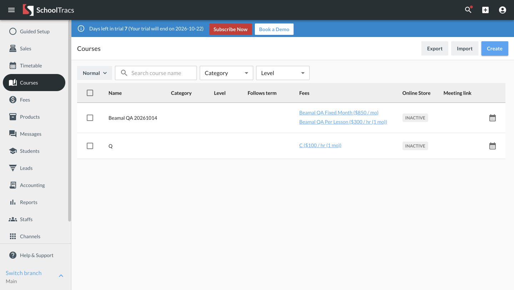
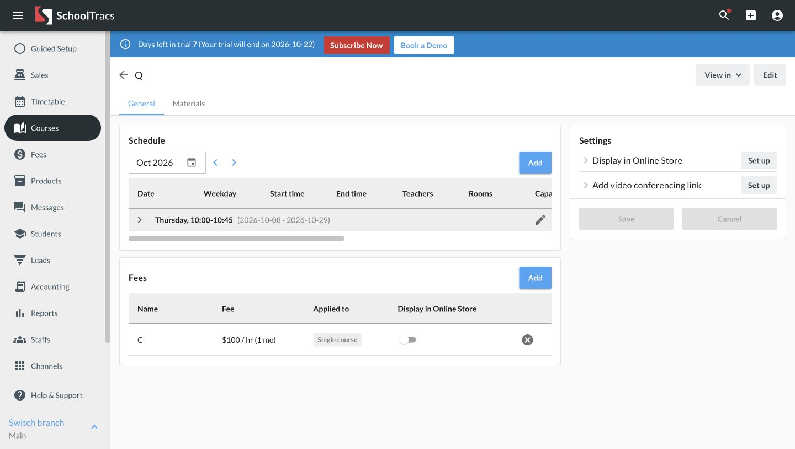
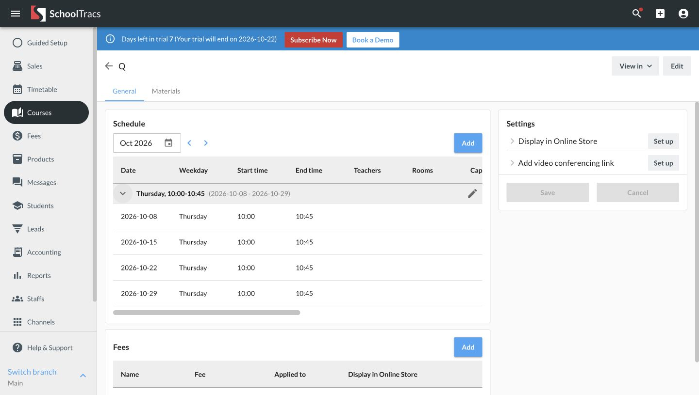
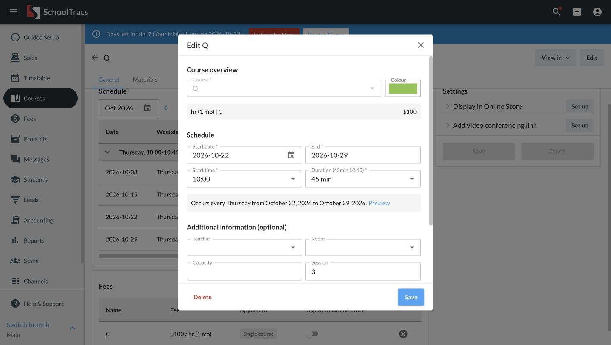
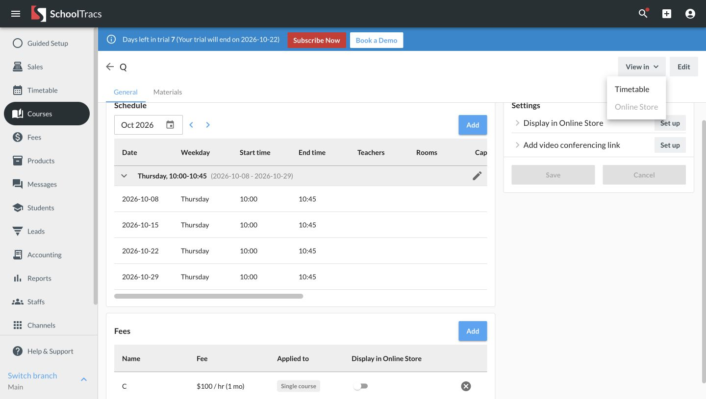
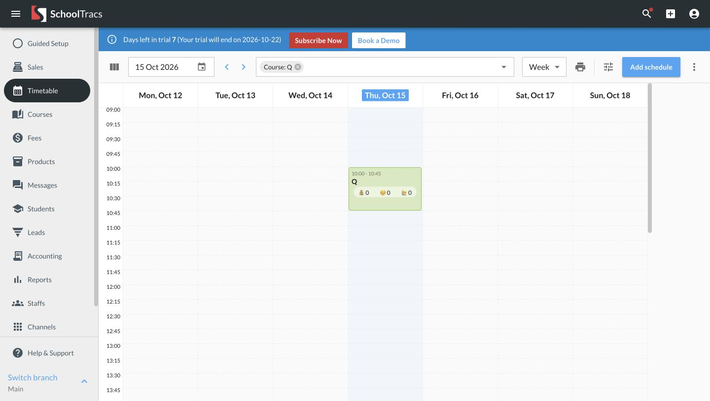
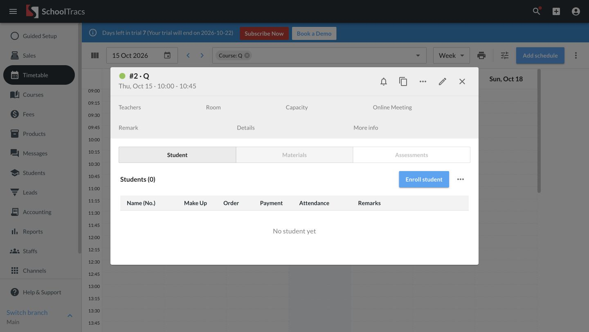
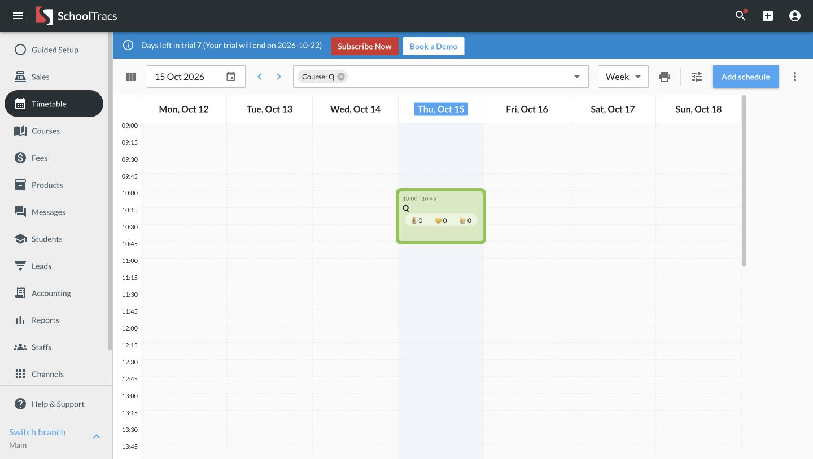

# SchoolTracs 課程與時間表：先理解原因，再決定 Beamal 流程

日期：2026-10-15。來源為本次 Chrome 已登入的 SchoolTracs，桌面畫面 1440×815；參考課程 Q。只查看、展開、開啟編輯器及取消；沒有保存、刪除、報名、收款或更改設定。

## 研究問題及證據界線

用戶要找到某課程的排課，理解哪天上課，再處理該堂的學生。研究重點是入口位置、資料關聯及返回成本。「實際觀察」指這次看到並操作的行為；「推論」是根據效果提出的設計解釋，不代表已知道 SchoolTracs 設計者的原意。

Beamal 的對照部分來自目前程式審查，不冒充本次三角色實際操作結果。本文件列出後續改善及驗收條件，沒有把方案寫成已實作。

## 三段操作與畫面

### 1. 課程清單 → 詳情 → 展開排課：結構清楚

**實際觀察：** 清單把建立、匯入及匯出放在頁首；每個課程列有費用連結及 View in Timetable。課程詳情把 Schedule、Fees、Settings 分組；排課與費用各有自己的 Add。定期課堂先顯示星期、時間及起訖日期，展開後列出四個實際日期。

**推論：** 全域建立是新增一個課程；局部 Add 沿用所選課程，避免重新選課程。定期規則與逐堂日期分開，有助先掌握整體再找例外，減少一開始就面對大量重複列。

**第一性原理：** 必需的對象是「哪個課程、哪套規則、哪一堂」，不是填滿一頁欄位。Beamal 應保持對象清楚，安排操作時沿用已知資料。這不證明 300 人名冊、四位老師或六種課程的情境已驗證。

### 2. 點課程內的日期 → 編輯 → 取消：資料有延續，入口含義可再清楚

**實際觀察：** 點 2026-10-22 後，稍後開啟 Edit Q 表單；開始日期為 10-22、結束為 10-29、Session 為 3，課程固定為 Q。關閉後仍在原課程、10 月及已展開的排課。未按 Save，因此沒有驗證保存範圍、確認步驟或實際修改結果。

**推論：** 沿用所點日期及課次可以避免改錯起點。不過日期外觀接近一般文字，使用者未必預期點擊是進入編輯；不能因參考系統如此便斷定這一定適合 Beamal。

**第一性原理：** 「查看誰上課」不需要寫入；「修改時間」需要明確的修改對象及範圍。Beamal 的查看與編輯入口應可辨識，並在真的修改時保留單堂／往後課堂等必要確認，不以減少步數為理由省略。

### 3. View in → 課程時間表 → 課堂名冊 → 關閉：工作情境延續良好

**實際觀察：** View in 提供 Timetable；轉到時間表後可見 Course: Q，網址亦帶課程選擇，毋須重新搜尋。顯示當天 10 月 15 日所在週，沒有沿用剛才在編輯器點過的 10 月 22 日；這是整個課程的時間表入口，不是「查看那一堂」。

點時間表的 Q 會開啟該堂詳情，標題顯示第 2 堂、課程、星期、日期及時間；下方預設 Student，名冊有 Order、Payment、Attendance 等欄位。Enroll student 靠近名冊，Edit activity 在標題工具列。關閉後仍保留 Q 篩選及 10 月 12–18 日，原課堂有明顯外框。

**推論：** 名冊及出席屬該堂的日常工作，留在課堂內可減少跨頁查找；編輯排課是另一個意圖。標題同時顯示日期、時間及課次，幫助操作前確認正在處理哪一堂。關閉後保留原畫面，方便繼續處理鄰近課堂。

**第一性原理：** 不應讓頁面的技術分工打斷同一任務。Beamal 要保留課堂身分及來源位置；「整個課程時間表」與「定位這一堂」應分清。名冊、訂單及付款仍有不同對象和狀態，不能自動假設加入名冊等於已付款。

## Beamal 目前程式對照及後續驗收

| 真正任務 | 目前程式對照 | 下一項改善及完成條件 |
|---|---|---|
| 看某堂由誰上課 | `course-schedule-ui.js` 日期進入編輯；已有課次識別。`src.js` 共用模式課程表的學生數仍為「—」。時間表已有課堂詳情及名冊入口。 | 清楚區分查看與修改，利用現有詳情讓已授權角色查看該堂；只查看不得產生寫入。名冊載入、沒有學生及失敗須可分辨，不能以假數字代替。 |
| 看該堂在整體時間表的位置 | `src.js` 課程 View in 保留課程篩選，沒有帶精確課次；既有老師／課室等篩選可能使目標不可見。 | 分清整個課程及精確一堂的入口；後者跳準日期並標示目標。不能因改畫面篩選而增加資料權限，返回保留原月份及展開位置。 |
| 從名冊處理訂單後繼續工作 | `src.js` 開啟訂單會清走所選課堂，關閉不還原名冊。 | 取消回同一堂名冊；成功後重讀該堂資料，保留焦點。學生、費用、金額及付款狀態仍需正確確認，不能自動當作 Paid。 |

優先次序：查看課堂入口 → 跨頁定位及返回 → 訂單返回。以上為待實作及驗收項目，不是本次已完成的產品修改。

## 可見風險與仍需驗證

- 日期看來像普通文字卻開啟編輯，屬入口可理解性的風險；是否導致誤操作仍需真實使用者測試。
- 部分純圖示控制項（例如課堂關閉）在可存取樹中沒有名稱；時間表視圖選擇出現 Without label。這是標籤風險，不能由幾張圖推論全面無障礙合規或不合規。
- 這個參考課堂沒有學生，老師、課室及班額未填；不能據此驗證真實點名、收費、班額競爭或四位老師安排。
- 本次沒有保存、付款或發送，沒有測手機、完整鍵盤、讀屏及效能。載入需要時間，短暫未變不能當作操作無效；已等真正表單／名冊顯示再接下一步。
- 參考系統的配色、圖示位置及資訊密度不是 Beamal 必須照搬的規則。採用理由須回到用戶任務，沿用 Beamal 風格、雙語與手機要求。

## 之後每頁的研究記錄

依 [UX 品質標準](UX-QUALITY.md) 記：實際路徑與畫面 → 每一步解決的問題 → 推論及代價 → Beamal 對照 → 採用或改善理由 → 正常、取消、錯誤與跨角色驗收。沒有證據的原因留作假設，下一輪再驗證。

本次只更新研究與品質文件；沒有修改應用程式，故沒有重跑上一輪已通過的功能測試或建置。仍在 `test` 本機工作區，未提交、未推送。
