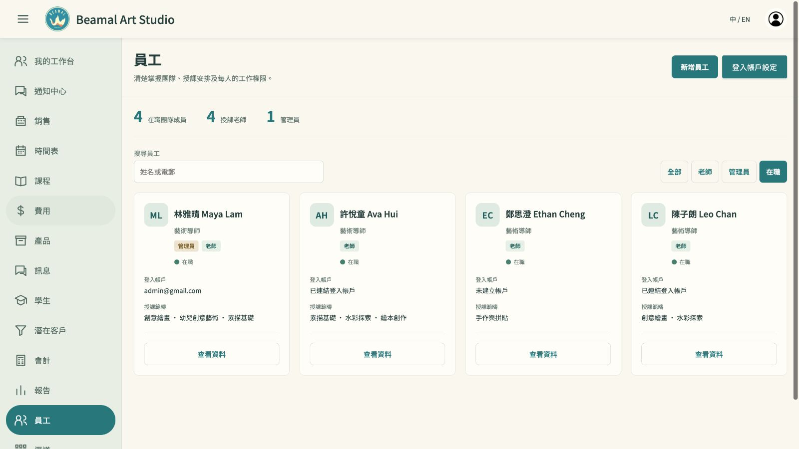
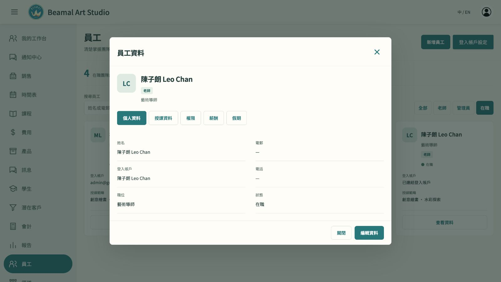
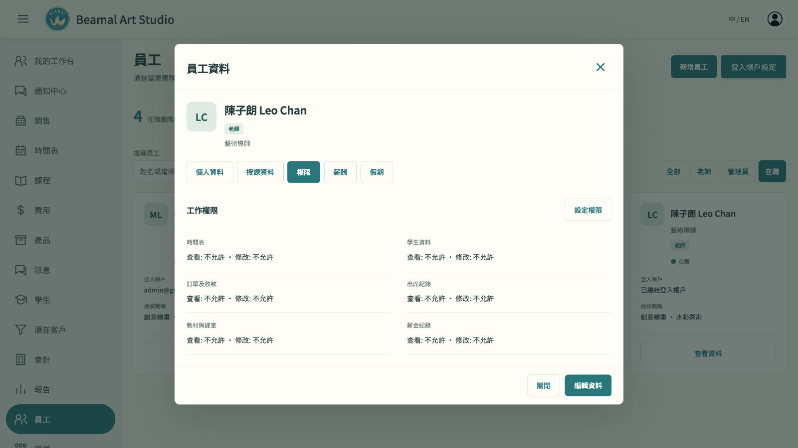
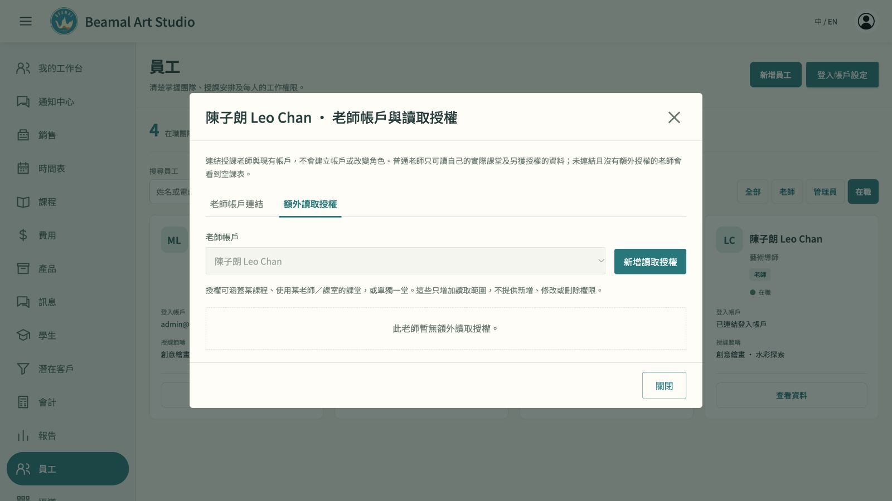
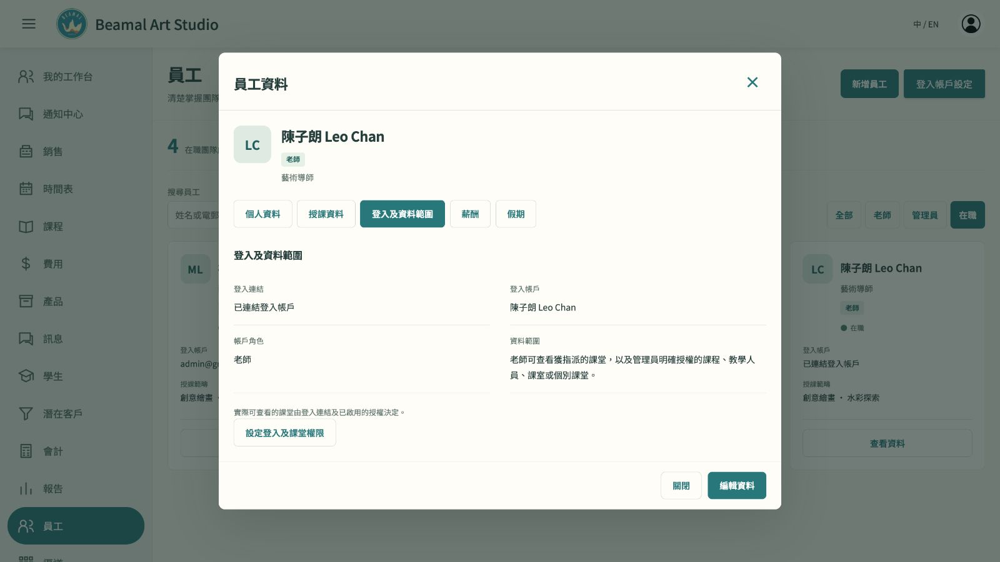

# 2026-10-15：以顧客任務驗收 UI／UX

## 結論與範圍

已把 UI／UX 列為和功能正確性同等重要的交付條件，並建立 [逐頁品質標準](UX-QUALITY.md)。本次先實際修正「管理員查看及設定某位老師的資料範圍」：移除與實際狀態不符的全數「沒有權限」，由個別老師直接進入該人的真正設定，關閉後回同一老師及原分頁。

這是參考設計原則後的工程審查及本機操作走查；未做真實老師、學生或家長訪談，不代表全系統已完成驗收，也不代表已全面符合無障礙標準。沒有更改實際帳戶連結或授權資料。

## 任務卡

- 角色：本機管理員兼老師；登入後查看普通老師 Leo。
- 目標：知道這位老師的登入及資料範圍，需要時可直接找到該人的設定，再返回原工作。
- 起點：員工清單；成功結果：全程維持同一人，資料說明與真正帳戶角色一致，不必去全校設定重新找人。
- 證據：使用者明確要求老師權限放在個別員工內；本次畫面、程式測試及獨立 Agent 審查。沒有把推測當作使用者訪談。
- 本次主要實際畫面：桌面 1600 CSS px，中英文；手機另核對 DOM 寬度及操作，截圖限制見下。

## 實際操作步驟及健康狀態

1. **員工清單 → Leo 資料：入口清楚。** 四位在職老師在同一清單，從姓名可開啟本人資料，管理員兼老師仍屬同一團隊。
   
   
2. **Leo → 登入及資料範圍：修正誤導。** 原畫面所有模組均寫「沒有權限」，但 Leo 已能查看其授課課堂，會令管理員誤判。現改為真實的登入連結、帳戶角色、指派課堂及額外讀取授權說明；不能從未知資料推斷「沒有權限」。
   
   
3. **設定登入及課堂權限 → 關閉返回：保留操作情境。** 開啟即鎖定 Leo 的實際帳戶，不會預選清單第一位老師；沒有額外授權不等於沒有自己的課堂。關閉後回 Leo 的相同分頁，鍵盤焦點回原按鈕。
   
   

## 問題與處理

| 優先度／對應步驟 | 問題及影響 | 處理與證據 |
|---|---|---|
| 高／2 | 不實的「沒有權限」會令管理員誤以為老師無法上課或系統設定錯誤。 | 已移除共用資料下沒有實際依據的權限矩陣，改為帳戶與資料範圍摘要；截圖 03／04。細分模組編輯權限仍須後續按正式政策接駁，不能用假矩陣代表已完成。 |
| 中／3 | 從員工資料跳去全校設定，再找同一人，增加搜尋及選錯人的機會。 | 已提供個人設定入口，以固定資料識別碼保持同一人；截圖 05，防止錯用第一個同名／其他帳戶的程式測試。 |
| 中／3 | 關閉或取消若丟失原人物及分頁，會打斷管理工作。 | 已返回同一人、同一分頁，焦點回入口；截圖 06，取消、載入中關閉及遲到回應測試。 |
| 高／3 | 表單開啟期間若帳戶連結已改，可能把舊表單用在另一人身上。 | 送出前核對當前帳戶連結及版本；不一致時要求重開，不寫入。以隔離測試驗證，沒有在實際示例帳戶試改授權。 |

## 語言、手機及鍵盤證據

- 英文桌面已目視核對同一帳戶、標題、操作及返回路徑：[英文畫面](evidence/ux-20261015/07-leo-settings-en.jpg)。中文正常桌面恢復後亦已再看完整標題和按鈕：[完整中文設定](evidence/ux-20261015/10-leo-settings-restored-desktop.jpg)。
- 手機中英文實際 DOM 量得視窗與頁面均為 **390 CSS px**，設定帳戶仍為 Leo，關閉操作可用；按鈕直排，未發現頁面級橫向溢出。本次瀏覽器縮窄截圖的輸出裁去上方標題，故 [英文手機截圖](evidence/ux-20261015/08-leo-settings-mobile-en.jpg) 及 [中文手機截圖](evidence/ux-20261015/09-leo-settings-mobile-zh.jpg) **只作局部證據，不能算完整手機目視驗收通過**。768px／1280px 及真機全流程仍待逐頁驗收。
- 實際關閉設定後，焦點回「設定登入及課堂權限」；按 Tab 到下一個「關閉」，`:focus-visible` 為 true。這只覆蓋本條路徑，不代表完整鍵盤及無障礙驗收。
- 測試後已移除臨時手機視窗設定、關閉工程驗收分頁，保留使用者原有網站分頁。

## 測試與獨立審查

- `npm test --prefix sample`：**722／722 通過**，0 失敗、0 跳過。
- `npm run build --prefix sample`：通過；仍有 Vite 現有的大檔案分包提示，不能據此宣稱所有效能目標已通過。
- 新增／擴充測試覆蓋：指定老師、未連結老師、管理員兼老師、取消返回、載入中關閉、連結已改及錯誤目標不得寫入；固定帳戶篩選及真正表單的資料傳遞。
- 由未製作根層整合的另一 Agent 獨立審查本次個人設定接駁，未發現阻擋問題。這是工程審查，不是客戶研究。
- 分支為 `test`；未提交、未推送，未操作 `main`，未修改 AGENTS.md。

## 下一輪優先問題（程式流程審查，尚未逐條目視驗收或修正）

| 任務 | 發現及下一步 |
|---|---|
| 課程 → 課堂／入班 | 日期操作目前偏向編輯；從課程進入入班仍需跨時間表重新選擇。應先明確課堂詳情，再延用已選課程及課堂進行入班。 |
| 300 位學生中找人 | 入班的純下拉選擇及整批帳戶連結表單增加尋找成本。優先改善搜尋，以及由個別學生處理其設定。 |
| 老師 → 名冊 → 點名 | 點名介面返回時可能清走原選課堂，回到工作台。下一輪保留課堂及名冊情境，避免重新找課。 |
| 學生 → 下一堂 | 日曆入口偏向直接打開調課表單；應先清楚顯示上課資料，再讓用戶明確選擇調課等操作，並補齊課室與雙語用語。 |

以上是下一輪的候選問題，會按 [品質標準](UX-QUALITY.md) 補當前畫面、任務基線及修正後證據。維持先完成 UI 的工作次序，首要仍是課程與時間表；其他頁面沿用同一方法。
